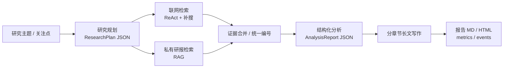
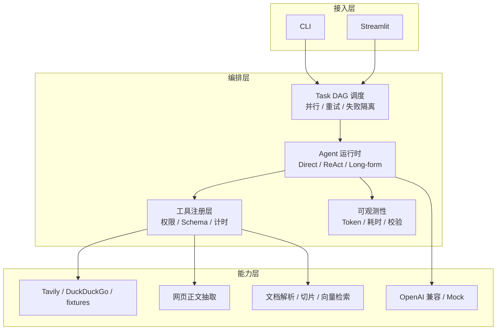

# IndustryInsight · 多 Agent 行业调研与数据分析系统

基于「研究员 → 分析师 → 撰写员」多角色协作的自动化行业研究系统：把 Tavily/网页检索、PDF/Word 研报解析、本地向量知识库与结构化报告生成串成一条可观测、可评测的流水线，实现「检索 → 解析 → 分析 → 成稿」闭环。

项目支持**零 API Key 的离线演示**（Mock LLM + fixtures 检索 + 内置知识库），也支持通过 OpenAI 兼容接口接入 DeepSeek / OpenAI / Qwen / Moonshot 等真实模型。

---

## 1. 项目亮点

- **多 Agent 协作引擎**：研究员、分析师、撰写员职责与工具权限分离；用 Task 依赖图组织流水线，`collect_web` 与 `collect_kb` 并行执行，证据合并后再进入分析与写作；角色、工具、任务均由 YAML 配置，可扩展新角色。
- **ReAct + 自适应补搜**：研究员按 `Thought → Action → Observation` 循环调用搜索/网页解析工具，交付后用独立的 Coverage 质检判断证据是否充分；不足时基于缺口生成补充检索词，最多补搜 N 轮，而不是单轮问答。
- **RAG 知识库**：解析 PDF / Word / Markdown / TXT，使用 LangChain `RecursiveCharacterTextSplitter`（未安装时自动回退到等价实现）切片，向量化后存入内置 NumPy 向量库或 Chroma；检索采用**向量相似度 + 字符/词级词法重合**的混合排序，缓解长研报向量被稀释的问题；生成时融合本地私有知识与联网信息，并为每条事实保留 `[E#]` 证据编号。
- **Prompt 工程与结构化交付**：CoT 引导分析步骤，Few-shot/JSON 契约约束输出；Pydantic 校验 + 格式纠错重试；报告按大纲分章节生成，避免单次长文被截断，最后统一校验章节、字数、引用与 Markdown 表格。
- **数据驱动迭代**：逐次记录各 Agent / 各阶段的 Token、耗时、工具调用、校验重试、补搜轮次，写入 `events.jsonl` 与 `metrics.json`；内置 **501 题机器人行业评测集**（493 可回答 + 8 不可回答）与 61 题早期演示集，以及 `build-eval` 构建器（支持规则抽取 / 真实 LLM 生成），可扫描 Top-K 与相似度阈值、对比闭卷/RAG、输出分类准确率与 95% 置信区间。
- **可演示的前端**：Streamlit 页面支持生成报告、查看证据链/分析 JSON/指标、下载 Markdown/HTML、增量导入研报、浏览历史运行。

> 离线演示默认生成约 **6,400 字符（约 3,900 汉字）**的中文报告（Mock 模式，约 0.2 秒完成）。真实模型下通过 `target_chars` 控制篇幅，写作按章节调度，支持万字级初稿。

---

## 2. 架构与流水线





**Task DAG**

```
plan
 ├── collect_web ──┐
 └── collect_kb ───┴── merge_evidence ── analyze ── write
```

- `collect_web` 与 `collect_kb` 是两个独立分支，由线程池并行执行；
- `merge_evidence` 是确定性节点，负责去重、重新编号，保证分析师与撰写员引用同一套 `E1..En`；
- 任一任务失败会重试指定次数，仍失败则隔离并跳过依赖它的下游任务，不影响无关分支。

---

## 3. 快速开始

要求 Python 3.10+（已在 Python 3.10.11 / Windows 验证）。

```powershell
# 1. 创建虚拟环境
D:\python3.10\python.exe -m venv .venv
.\.venv\Scripts\Activate.ps1

# 2. 安装依赖
pip install -r requirements.txt

# 3. 在 .env 配置 ZHIPU_API_KEY 后，生成示例研报并构建知识库
#    （默认使用 GLM embedding-3）
python -m app.cli bootstrap

# 4. 一键运行离线演示（Mock LLM + fixtures + 独立 hashing 索引，无需 Key）
python -m app.cli demo

# 5. 启动 Streamlit
python -m app.cli ui
```

> 只想快速跑通流程时，可跳过第 3 步直接执行 `demo`；`demo` 使用 `data/index_demo` 的离线 hashing 索引，不会覆盖 `data/index` 中的正式索引。

产物写入 `runs/<run_id>/`：

| 文件 | 说明 |
| --- | --- |
| `report.md` | 最终报告 |
| `report.html` | 自包含 HTML 版本（含运行指标与证据索引） |
| `plan.json` | 研究规划 |
| `evidence_web.json` / `evidence_kb.json` | 两路原始证据 |
| `evidence.json` | 合并、统一编号后的证据包 |
| `analysis.json` | 结构化分析 |
| `metrics.json` | Token / 耗时 / 成本 / 瓶颈阶段 |
| `events.jsonl` | 逐事件日志（LLM、工具、校验、补搜） |
| `run.log` | 运行日志 |

> `data/raw` 下的 `nev_*` 演示研报与 `data/fixtures/` 为**合成演示数据**；`data/raw/robotics/` 的 6 份研报与 `qa_robotics_v2.jsonl` 来自公开研报，仅用于工程评测，不构成真实研究结论。

---

## 4. 接入真实模型与联网检索

复制 `.env.example` 为 `.env`：

```ini
INSIGHT_PROVIDER=deepseek
INSIGHT_MODEL=deepseek-chat
DEEPSEEK_API_KEY=sk-xxx

# 可选：Tavily（未配置时在线检索回退 DuckDuckGo，失败再回退 fixtures）
TAVILY_API_KEY=tvly-xxx
```

> `.env` 中的 `INSIGHT_PROVIDER` / `INSIGHT_MODEL` / `INSIGHT_BASE_URL` 会在配置加载时覆盖 `settings.yaml`；CLI 的 `--provider` 参数优先级更高。

运行：

```powershell
python -m app.cli run `
  --topic "中国新能源汽车行业（2024）" `
  --focus "重点关注价格战、竞争格局与海外市场" `
  --provider deepseek `
  --online `
  --target-chars 10000
```

Provider 预设：`mock`、`openai`、`deepseek`、`qwen`、`moonshot`、`zhipu`。任意 OpenAI 兼容网关可通过 `config/settings.yaml` 的 `base_url` 与 `api_key_env` 配置。

### RAG 可选后端

默认使用内置 NumPy 向量库（零重型依赖、可持久化、支持离线演示）。也可以切换到 Chroma：

```powershell
pip install -r requirements-optional.txt
# config/settings.yaml: rag.backend: chroma
python -m app.cli bootstrap
```

Chroma 与内置实现共用 `VectorStore` 接口；Embedding 默认使用智谱 **GLM `embedding-3`**（需要 `ZHIPU_API_KEY`），也可在 `rag.embedding` 下切换为 `openai` 或离线的 `hashing`。

---

## 5. 评测与调参

### 5.1 检索评测（无需 API Key）

```powershell
python -m app.cli eval `
  --qa-file data/eval/qa_robotics_v2.jsonl `
  --limit 100 `
  --top-k 8 `
  --thresholds 0.15
```

使用机器人行业评测集 `qa_robotics_v2.jsonl`：共 **501 题**（493 道可回答 + 8 道不可回答），其中前 **100 道可回答题**用于检索 / 问答对照。索引为 6 份公开研报（4 份年报 + 2 份 IFR 执行摘要）、992 页、**1896 个切片**（GLM embedding-3，2048 维；索引另含 3 份演示语料的 6 个切片；Hashing 评测快照为 1890 切片 / 6 sources）。

| 配置 | Top-K | 阈值 | 命中率 | MRR | 平均耗时 | 产物 |
| --- | ---: | ---: | ---: | ---: | ---: | --- |
| GLM embedding-3 + `company/report_year` 过滤 | 8 | 0.15 | **97%** | **0.8889** | ~175 ms | `runs/eval_results.json` |
| GLM embedding-3，补全公司/年份但不过滤 | 8 | 0.15 | 88% | 0.7416 | ~183 ms | `runs/eval_results_100_grounded_nofilter.json` |
| GLM embedding-3，原始题目（未补全公司/年份） | 8 | 0.15 | 93% | 0.8201 | ~188 ms | `runs/eval_results_100_glm_ungrounded.json` |
| Hashing-768 离线基线 | 8 | 0.15 | 89% | 0.8003 | 10.88 ms | `runs/eval_results_hashing.json` |

- 检索相关性按 `evidence_quote` / 标准答案 / 来源页码判断，不再只看单个关键词。
- 不可回答题不参与检索命中率计算，单独统计拒答准确率。
- 这里的「命中率」只衡量**检索是否召回了包含原文证据的切片**，不等于最终问答准确率。
- 全量 501 题的 `97.16% / MRR 0.884` 属于历史运行，当前仓库未保留对应产物；文档与面试统一使用上表的 100 题数字。

### 5.2 如何构建一套能支撑简历数字的评测集

简历里的「闭卷 14% → RAG 90%」需要三类证据：**足够大的题量、可回溯的 gold answer、真实模型的闭卷/RAG 对比**。当前主用评测集与推荐流程如下。

#### 第一步：确定题量与题型分布

20 题太少（1 题 = 5 个百分点）。当前主用 `qa_robotics_v2.jsonl` 共 **501 题**（493 可回答 + 8 不可回答）；检索与问答对照使用前 **100 题**（全部可回答）：

| 类型 | 数量 | 示例 |
| --- | ---: | --- |
| 财务/经营数据 | 301 | 研发投入、净利润、经营现金流 |
| 产品/业务 | 82 | 产品线、订单、产能 |
| 市场/份额 | 61 | 市占率、出货量 |
| 展望/预测 | 21 | 增速区间、行业预测 |
| 政策/监管 | 18 | 补贴、关税、行业政策 |
| 竞争格局 | 10 | 竞争对手对比 |
| 不可回答/应拒答 | 8 | 未披露的净利润、未给出的单车毛利率 |

早期 `qa_v2.jsonl`（61 题，53 可回答 + 8 不可回答）保留为小样本演示集，不再作为简历数字来源。  
建议再补一层**私有研报/内部数据**：公开数据模型可能“闭卷也会”，私有数据才能真实拉开闭卷与 RAG 的差距。

#### 第二步：用构建器生成候选，再人工抽检

```powershell
# 离线规则抽取（无需 API Key，适合演示）
python -m app.cli build-eval --provider mock --per-chunk 4 --out data/eval/qa_v2.jsonl

# 真实模型生成（推荐；可给自己的研报库用）
python -m app.cli build-eval `
  --provider deepseek `
  --per-chunk 3 `
  --out data/eval/qa_private.jsonl `
  --no-seed --no-legacy
```

每条评测数据必须包含：

```json
{
  "id": "fin_q001",
  "question": "2024 年比亚迪的新能源汽车市场份额是多少？",
  "gold_answer": "33.2%",
  "answer_aliases": ["33.2", "33.2%"],
  "evidence_quote": "比亚迪以 33.2% 的份额保持第一，特斯拉中国份额约 6.0%",
  "source": "nev_2024_competition.docx",
  "page": null,
  "category": "competition",
  "difficulty": "easy",
  "answerable": true,
  "requires_calc": false
}
```

构建器会自动做：证据片段校验（必须是原文子串）、答案去重、分类统计、丢弃无法回溯的题。  
**但自动生成的题必须人工抽检**：问题是否有歧义、答案是否唯一、口径是否一致。

#### 第三步：跑闭卷 vs RAG

```powershell
python -m app.cli eval `
  --qa-file data/eval/qa_robotics_v2.jsonl `
  --limit 100 `
  --provider zhipu `
  --with-qa `
  --top-k 8 `
  --thresholds 0.15
```

输出包含：

- 总体准确率 + 95% Wilson 置信区间；
- 可回答题准确率、不可回答题拒答率；
- 按 category 的闭卷/RAG 对比；
- 逐题明细写入 `runs/eval_results.json`。

评测口径：同一个模型、同一套 system prompt；闭卷只给问题，RAG 给同一题的 `company` / `report_year` 过滤后的 Top-K 切片；数值题按数字/单位/别名匹配，不可回答题只有明确拒答才算对。

本项目实测（100 题）：

| 配置 | 闭卷 | RAG | 提升 | 95% CI（RAG） | 产物 |
| --- | ---: | ---: | ---: | --- | --- |
| GLM + GLM embedding-3 + 元数据过滤 | 14% | **90%** | +76pp | 82.6%–94.5% | `runs/eval_results.json` |
| deepseek-chat + Hashing | 16% | 88% | +72pp | 80.2%–93.0% | `runs/eval_results_hashing.json` |
| GLM + 原始题目（未过滤，历史） | 10% | 84% | +74pp | 75.6%–89.9% | `runs/eval_results_100_glm_ungrounded.json` |

#### 第四步：把真实结果写进简历

如果真实跑出来是 62% → 88%，就写 **62% → 88%**，不要硬凑 60/90；差距本身比整数好看更可信。  
如果闭卷准确率过高（例如 90%），说明题目大多是模型已知的公开事实，应加入私有研报、内部财务表或更细的数字题。  
如果 RAG 低于 90%，按以下顺序迭代并记录每次结果：

1. `chunk_size` / `chunk_overlap`（当前 900 / 150）；
2. `top_k` / `score_threshold`（当前 5 / 0.15）；
3. Embedding：Hashing → GLM `embedding-3` / OpenAI `text-embedding-3-small`；
4. Prompt：要求先定位证据再回答、数字保留单位；
5. 对计算题在 RAG 上下文中显式给出公式。

简历可用的表述模板：

> 构建 501 题机器人行业评测集（493 可回答 + 8 不可回答），取前 100 题基于 6 份研报（992 页 / 1896 切片）的自建知识库对比闭卷与 RAG：闭卷准确率 **14%**，RAG 后 **90%**，提升 **76 个百分点**（95% CI 82.6%–94.5%）；Top-8、阈值 0.15 下检索命中率 **97%**、MRR **0.8889**。

注意：当前 100 题检索/问答对照取的是评测集前 100 行，全部来自埃斯顿年报，存在来源偏差；剩余题库覆盖拓斯达、汇川、新时达与 IFR。正式求职建议按 source 分层抽样或跑全量，并加入 1–2 份私有研报。

### 5.3 可观测性

每次运行都会聚合：

- 按 Agent：Token、LLM 调用数、工具调用数、任务耗时；
- 按阶段：`research_plan`、`web_research`、`web_research#followup1`、`kb_research`、`analysis`、`report_writing#1..N`；
- 校验重试次数、工具失败次数、补搜轮次、慢阶段 Top-3、估算成本。

调整 `config/settings.yaml` 中的 `top_k`、`score_threshold`、`chunk_size`、`max_react_steps` 后重跑并对比 `metrics.json`，即可形成数据驱动的迭代记录。

---

## 6. 目录结构

```
.
├── app/
│   ├── cli.py                  # bootstrap / ingest / run / demo / build-eval / eval / ui
│   ├── config.py               # settings / agents / tasks 配置加载
│   ├── schemas.py              # ResearchPlan / EvidenceBundle / AnalysisReport
│   ├── sample_data.py          # 合成研报生成（PDF/Word/Markdown）
│   ├── agents/
│   │   ├── prompts.py          # CoT、Few-shot、ReAct、写作规范
│   │   ├── researcher.py       # ReAct 检索 + 充分性质检 + 补搜
│   │   ├── analyst.py          # 证据清洗 + 结构化分析
│   │   ├── writer.py           # 大纲分章节长文写作
│   │   ├── merger.py           # 证据去重与统一编号
│   │   └── factory.py          # 按任务构建 Agent 实例
│   ├── core/
│   │   ├── agent.py            # Direct / ReAct 运行时、校验重试
│   │   ├── crew.py             # Task 依赖图、并行调度、失败隔离
│   │   ├── llm.py              # OpenAI 兼容 LLM、重试、Token 统计
│   │   ├── mock_llm.py         # 离线演示模型
│   │   ├── tools.py            # 工具注册 / 权限 / 计算器
│   │   ├── search.py           # Tavily / DDG / fixtures + 网页正文抽取
│   │   ├── structured.py       # JSON 抽取、Pydantic 校验、Markdown 契约
│   │   ├── tracker.py          # events.jsonl / metrics.json
│   │   └── logging_utils.py
│   ├── rag/
│   │   ├── loaders.py          # PDF / DOCX / MD / TXT
│   │   ├── splitter.py         # LangChain RecursiveCharacterTextSplitter 封装
│   │   ├── embeddings.py       # GLM embedding-3 / OpenAI / Hashing
│   │   ├── store.py            # 本地 NumPy 向量库 + Chroma 适配
│   │   └── knowledge.py        # 入库、混合检索、阈值、持久化
│   ├── pipeline/
│   │   ├── runner.py           # 端到端编排与产物落盘
│   │   ├── evaluator.py        # 检索 / 问答评测（数值匹配、CI、分类）
│   │   ├── eval_schema.py      # 评测字段契约
│   │   └── qa_builder.py       # 评测集构建（LLM / 规则抽取）
│   ├── reporting/              # Markdown -> HTML
│   └── ui/streamlit_app.py
├── config/
│   ├── settings.yaml
│   ├── agents.yaml             # 角色、工具权限、模式
│   └── tasks.yaml              # 任务、依赖、交付契约
├── data/
│   ├── raw/                    # 研报（robotics/ 下 6 份公开研报，992 页）
│   ├── fixtures/               # 离线搜索与网页
│   └── eval/
│       ├── qa.jsonl            # 20 题旧版评测集（兼容）
│       ├── qa_seed.jsonl       # 人工种子题（含计算/比较/不可答）
│       ├── qa_v2.jsonl         # 61 题早期演示集（53 可答 + 8 不可答）
│       └── qa_robotics_v2.jsonl # 501 题机器人行业评测集（当前主用）
├── tests/                      # 8 个测试文件、36 个测试函数
└── runs/                       # 运行产物（gitignore）
```

---

## 7. 关键实现说明（面试可讲）

### 7.1 为什么是自研编排内核，而不是直接 import CrewAI？

本项目参考 CrewAI 的 `Agent / Task / Crew` 抽象，实现了更轻量的编排内核：

- 需要真正的**并行分支 + DAG 依赖**（Crew 的 `context` 更偏顺序/层级）；
- 需要统一的**结构化交付校验与重试**（Pydantic + Markdown 契约），而不是只靠自然语言描述；
- 需要运行时**工具权限**、事件级 Token/耗时追踪与失败隔离；
- 避免框架版本升级对项目造成破坏，Python 3.10 下依赖更可控。

因此简历建议表述为：

> 参考 CrewAI 的 Agent/Task/Crew 抽象，自研轻量多 Agent 编排内核，支持 DAG 并行、工具权限、结构化交付与全链路观测。

如果面试官追问 CrewAI 细节，可以说明两者映射关系：`AgentSpec ↔ Agent`、`TaskSpec ↔ Task`、`Crew ↔ Process`；本项目把 CrewAI 的“角色/任务”配置化，并补上了它较弱的结构化校验与指标观测。

### 7.2 ReAct 与二次补搜

- ReAct 循环最多 `max_react_steps` 步；每次只能输出 `Action` 或 `Final Answer`；
- 工具结果以 `Observation` 注入，禁止模型编造；
- 首轮证据交付后，Coverage Agent 读取研究计划与证据摘要，输出 `CoverageDecision`；
- 若 `sufficient=false`，把 `followup_queries` 作为新的检索轮次重新进入 ReAct，证据合并去重后再次质检；
- 补搜失败或达到轮次上限时保留已有证据，不阻断主流程。

### 7.3 如何降低幻觉

1. 工具结果与研报切片是唯一事实来源，提示词要求“无来源写未获取”；
2. 分析师只允许引用证据包中存在的 `[E#]`，运行时还会清洗不存在的编号；
3. 报告参考文献与正文引用共用同一套编号；
4. 结构化输出校验失败会自动纠错重试，仍失败则该任务失败，而不是把脏数据写入报告；
5. RAG 检索支持相似度阈值，低于阈值的切片不会进入上下文。

### 7.4 长文写作如何避免截断

撰写员不一次性生成整篇报告，而是沿 `research_outline` 逐章节调用模型：

- 每节携带同一份分析 JSON、证据清单与写作要求；
- 单节字数不足会触发一次扩写重试；
- 最后统一补充关键指标表、研究局限与参考资料，并做整体契约校验（章节、字数、引用数、表格）。

### 7.5 如何做效果迭代

- 从 `metrics.json` 找耗时最高与 Token 最高的阶段；
- 用 `events.jsonl` 定位是 LLM 重试、工具失败还是补搜轮次导致；
- 调整 System Prompt、`chunk_size`、`top_k`、`threshold` 后重跑评测；
- 用 `runs/eval_results.json` 留存每轮参数与指标，形成可复盘的实验记录。

---

## 8. 测试

```powershell
python -m unittest discover -s tests -v
```

覆盖：JSON 抽取与校验、Markdown 契约、递归切片、DAG 并行/环检测/失败隔离、工具权限、fixtures 检索、网页正文抽取、知识库入库/持久化/阈值、评测集构建、数值/别名匹配、Wilson 置信区间、端到端 Mock 流水线。

---

## 9. 已知限制

- 离线 Mock 模式是**脚本化演示**，用于无 Key 环境跑通流程；真实结论必须接入真实模型与真实研报。
- 默认 Embedding 为智谱 GLM `embedding-3`（需要 `ZHIPU_API_KEY`）；`demo` 会自动使用离线 Hashing 索引。生产环境可选 OpenAI Embedding 或 Chroma + 领域向量模型。
- 当前主用评测集为 `qa_robotics_v2.jsonl`：501 题（493 可回答 + 8 不可回答），检索/问答对照使用前 100 题；该 100 题全部来自埃斯顿年报，存在来源偏差。97% 是**检索命中率**，不是问答准确率。
- 问答结果来自 `--with-qa` + 真实模型（GLM 配置 14% → 90%；Hashing + deepseek-chat 基线 16% → 88%），但不是语义判分；建议按 source 分层抽样或跑全量，并加入私有研报，否则闭卷基线可能因公开数据而被高估。
- Streamlit 为单机演示界面，未做登录、权限与并发任务队列。
- `data/raw/robotics/` 为公开研报，评测题由这些语料生成，存在同源偏差；报告中的示例数字仅用于验证流程，不能用于投资或商业决策。
