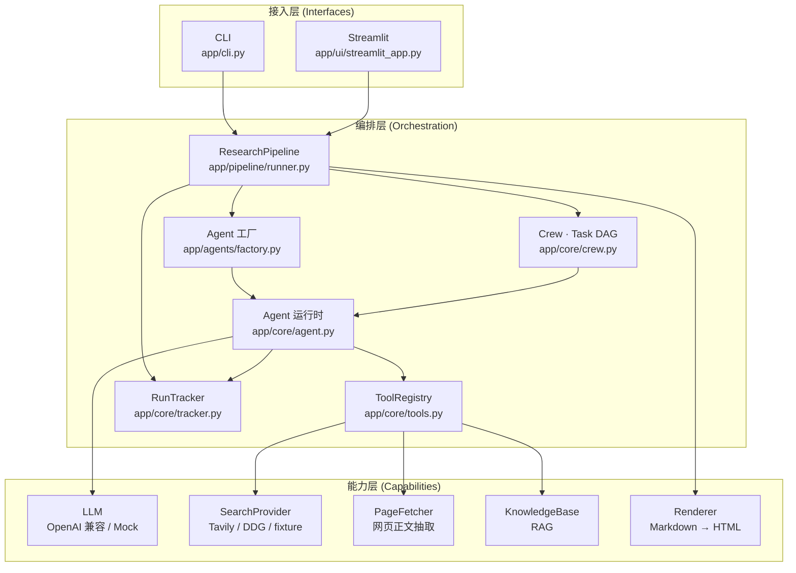
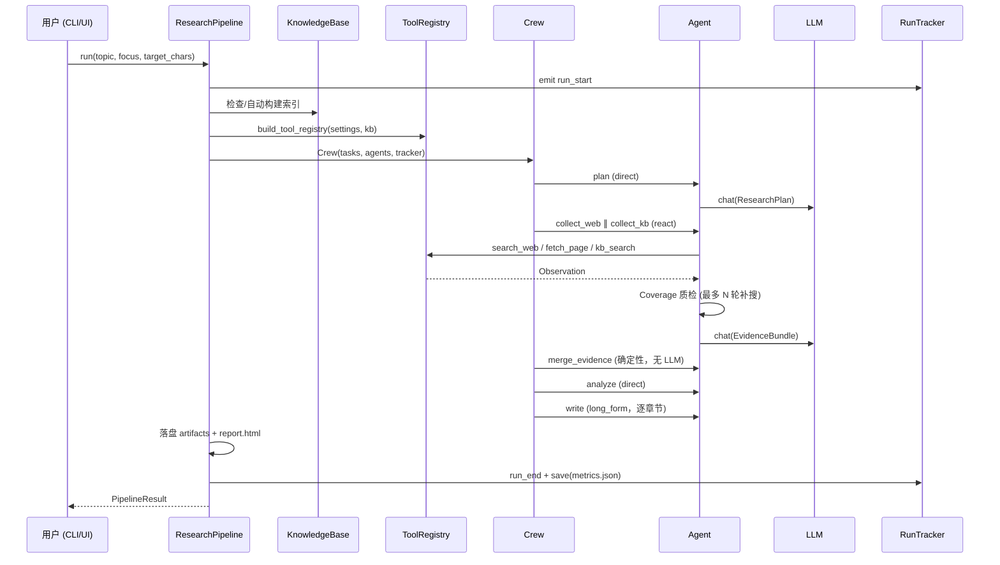
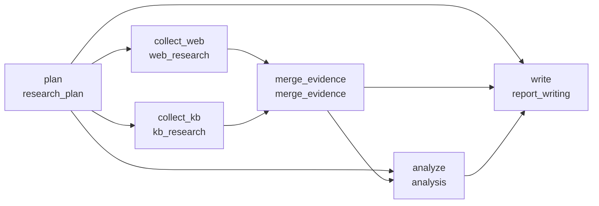
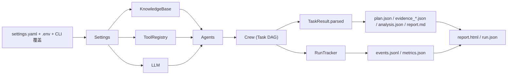

# 01 · 整体架构

## 1. 设计目标与约束

| 目标 | 实现方式 |
| --- | --- |
| 多角色职责分离 | `config/agents.yaml` 声明角色、目标、工具白名单；`config/tasks.yaml` 声明任务、依赖、交付契约 |
| 真实的并行分支 | `Crew` 按依赖图调度，`collect_web` 与 `collect_kb` 同一层就绪，线程池并行 |
| 结构化交付可校验 | Pydantic Schema + Markdown 契约；校验失败自动纠错重试 |
| 事实可溯源 | 所有事实写入 `EvidenceBundle`，合并后统一编号 `E1..En`，正文引用只能是这批编号 |
| 全链路可观测 | `RunTracker` 逐事件落盘并按 Agent / 阶段聚合 |
| 零 Key 可演示 | `MockLLM` + fixtures 搜索 + 内置知识库 |
| 依赖可控 | 不直接依赖 CrewAI / LangChain Agent 框架；LangChain 仅用于可选切片器 |

## 2. 分层架构



**分层约束（重要）**

- 接入层只负责参数收集、事件打印、结果展示，不含业务逻辑。
- 编排层不直接访问网络 / 向量库，一切外部能力通过 `ToolRegistry` 暴露给 Agent。
- 能力层不感知“任务 / 角色 / 证据”等业务概念（`Concept` 仅 `search.py` 返回通用 dict）。
- `app/schemas.py` 是跨层共享的数据契约，任何层都可以依赖它，但它不依赖其他业务模块。

## 3. 端到端运行时序



## 4. Task DAG



| 任务 | Agent | 模式 | 交付契约 | 关键点 |
| --- | --- | --- | --- | --- |
| `plan` | researcher | direct | `ResearchPlan` | 3–4 子问题 + 6–7 章大纲 |
| `collect_web` | researcher | react | `EvidenceBundle` | `coverage_check: true`，触发补搜 |
| `collect_kb` | researcher | react | `EvidenceBundle` | 至少 2 组 `kb_search` |
| `merge_evidence` | researcher（实例为 `MergerAgent`） | direct | `EvidenceBundle` | 不调用 LLM，确定性去重 + 重编号 |
| `analyze` | analyst | direct | `AnalysisReport` | 清洗非法 `E#` 引用 |
| `write` | writer | long_form | Markdown 契约 | 逐章节写作 + 统一装配参考资料 |

调度语义（[app/core/crew.py](../../app/core/crew.py)）：

1. 每轮先计算 **blocked**（任一依赖已失败）→ 标记跳过并删除。
2. 再计算 **ready**（全部依赖已完成）→ 并行或串行执行。
3. 若既无 ready 也无 blocked（图不可满足）→ 全部标记错误退出。
4. 单任务异常：重试 `max_task_retries` 次，仍失败则写入 `errors`，不中断其他分支。

## 5. 目录结构（带职责注释）

```
app/
├── cli.py                 # 命令行入口与 ConsoleProgress 事件打印
├── config.py              # Settings / AgentSpec / TaskSpec + YAML/环境变量加载
├── schemas.py             # ResearchPlan / EvidenceBundle / AnalysisReport / CoverageDecision
├── sample_data.py         # 合成演示研报（PDF/DOCX/MD）生成
├── agents/
│   ├── prompts.py         # 角色模板、ReAct 协议、各 kind 交付契约、写作规范
│   ├── factory.py         # 按 task.kind / agent key 选择 Agent 子类
│   ├── researcher.py      # ReAct + Coverage 质检 + 补搜合并
│   ├── analyst.py         # 证据引用清洗 + 结构化分析
│   ├── merger.py          # 证据去重、统一编号、空证据闸门
│   └── writer.py          # 大纲分章节写作 + 指标表 + 局限 + 参考资料
├── core/
│   ├── agent.py           # Direct / ReAct 运行时、工具权限、校验重试、截断处理
│   ├── crew.py            # Task DAG 调度、环检测、并行、失败隔离
│   ├── llm.py             # LLMResponse / BaseLLM / OpenAICompatibleLLM / create_llm
│   ├── mock_llm.py        # 离线确定性模型（按 stage 分发脚本化输出）
│   ├── structured.py      # JSON 抽取、Pydantic 校验、Markdown 契约
│   ├── tools.py           # 工具注册、参数收敛、权限、计时、安全计算器
│   ├── search.py          # Tavily/DDG/fixture 搜索 + 网页正文抽取 + PageFetcher
│   ├── tracker.py         # events.jsonl / metrics.json / 聚合与瓶颈排序
│   ├── types.py           # TaskResult / CrewResult
│   └── logging_utils.py   # 控制台 + 文件双通道日志
├── rag/
│   ├── loaders.py         # PDF / DOCX / MD / TXT → LoadedDocument
│   ├── splitter.py        # 递归切片（LangChain 优先，本地等价实现兜底）
│   ├── embeddings.py      # GLM embedding-3 / OpenAI / Hashing
│   ├── store.py           # LocalVectorStore（NumPy）/ ChromaVectorStore
│   ├── knowledge.py       # 入库、混合检索、阈值、统计、持久化
│   └── models.py          # LoadedDocument / Chunk / RetrievedChunk / IngestStats
├── pipeline/
│   ├── runner.py          # 端到端编排与产物落盘
│   ├── evaluator.py       # 检索命中率/MRR + 闭卷/RAG 问答评测
│   ├── eval_schema.py     # QA 数据契约与旧格式兼容
│   └── qa_builder.py      # 评测集构建（规则抽取 / 真实 LLM）
├── reporting/
│   ├── renderer.py        # Markdown → 自包含 HTML
│   └── report_template.html
└── ui/streamlit_app.py    # 生成 / 知识库 / 历史运行三页签

config/   settings.yaml · agents.yaml · tasks.yaml
data/     raw（研报）· fixtures（离线检索/页面）· eval（评测集）· index（向量索引）· uploads
runs/     每次运行的产物（gitignore）
tests/    8 个测试文件、36 个测试函数
```

## 6. 数据流与产物



| 产物 | 来源 | 内容 |
| --- | --- | --- |
| `plan.json` | `plan` 任务 `parsed` | 研究规划 JSON |
| `evidence_web.json` / `evidence_kb.json` | 两路检索 `parsed` | 原始证据包 |
| `evidence.json` | `merge_evidence.parsed` | 去重 + `E1..En` |
| `analysis.json` | `analyze.parsed` | 结构化分析 |
| `report.md` | `write.text` | 最终报告 |
| `report.html` | `renderer` | 自包含 HTML（含指标与证据索引） |
| `metrics.json` | `RunTracker.summary()` | Token / 耗时 / 成本 / 瓶颈 |
| `events.jsonl` | `RunTracker` | 逐事件日志 |
| `run.json` | `runner` | run_id、状态、错误、artifacts、meta |
| `run.log` | `logging_utils` | 人类可读日志 |

## 7. 关键设计决策

### 7.1 为什么自研编排内核而不是直接用 CrewAI

- 需要真正的 **DAG 并行 + 依赖失败隔离**，而不是顺序 / 层级上下文。
- 需要 **统一的结构化交付校验与重试**（Pydantic + Markdown 契约）。
- 需要 **运行时工具权限**（角色白名单 ∩ 任务白名单）与事件级追踪。
- 避免框架升级破坏兼容性，Python 3.10 依赖更可控。

映射关系：`AgentSpec ↔ Agent`、`TaskSpec ↔ Task`、`Crew ↔ Process`。本项目的增强点是把角色/任务完全配置化，并补上交付契约与指标观测。

### 7.2 证据合并必须是确定性节点

`merge_evidence` 是唯一不调用 LLM 的中间节点（[merger.py](../../app/agents/merger.py)）。原因：

- 两路检索各自从 `E1` 编号，若让 LLM 合并会产生不可控重编号；
- 去重键是 `(url | source:page, 归一化 claim 前 60 字)`，可稳定复现；
- 合并后若 `items` 为空，直接抛 `EvidenceUnavailableError`，阻止“空证据继续分析与写作”的静默失败（这是项目历史上踩过的坑，见 [08-operations.md](./08-operations.md#7-常见故障排查)）。

### 7.3 引用编号的单一事实来源

- 研究员输出本地 `E#` → 合并器统一重编号 → 分析师只能引用合并后的编号，运行时还会清洗不存在的编号 → 撰写员拿到的证据清单与正文引用同一套编号 → 参考资料由系统统一生成。
- 因此正文中的 `[E3]` 一定能对应到 `evidence.json` 中的第 3 条。

### 7.4 长文写作的分章节策略

撰写员不对整篇报告做一次生成，而是按 `report_outline` 逐章节调用（[writer.py](../../app/agents/writer.py)）：

- 每节携带同一份分析 JSON、证据清单、字数预算；
- 单节字数不足触发一次扩写重试；
- 最后统一补指标表、研究局限、参考资料，并做整体契约校验；
- 引用下限动态适配：`min(min_citations, len(evidence.items))`，避免证据不足时必然失败。

### 7.5 截断防御

结构化输出超过 `max_tokens` 时 `finish_reason == "length"`。系统在三个层面防御：

1. Prompt 约束输出规模（证据 ≤ 8 条、detail ≤ 120 字）；
2. Agent 检测 `finish_reason == "length"` 后注入压缩重述提示重试；
3. 证据类 Schema 使用 `extra="forbid"`，截断产生的残包不会被静默接受为空包。

## 8. 数据契约总览

| 契约 | 定义位置 | 用途 |
| --- | --- | --- |
| `ResearchPlan` / `SubQuestion` | [schemas.py](../../app/schemas.py) | 研究规划交付 |
| `EvidenceItem` / `EvidenceBundle` | 同上 | 证据交付（严格模式） |
| `AnalysisReport` / `MarketInfo` / `Metric` / `Competitor` / `Trend` / `Risk` | 同上 | 结构化分析 |
| `CoverageDecision` | 同上 | 证据充分性质检 |
| `AgentSpec` / `TaskSpec` | [config.py](../../app/config.py) | 角色与任务配置 |
| `LoadedDocument` / `Chunk` / `RetrievedChunk` / `IngestStats` | [rag/models.py](../../app/rag/models.py) | RAG 领域对象 |
| `TaskResult` / `CrewResult` | [core/types.py](../../app/core/types.py) | 任务执行结果 |
| `QAPair`（行级 dict 契约） | [pipeline/eval_schema.py](../../app/pipeline/eval_schema.py) | 评测集 |
| `PipelineResult` | [pipeline/runner.py](../../app/pipeline/runner.py) | 流水线返回值 |

继续阅读：[02-core-runtime.md](./02-core-runtime.md)
