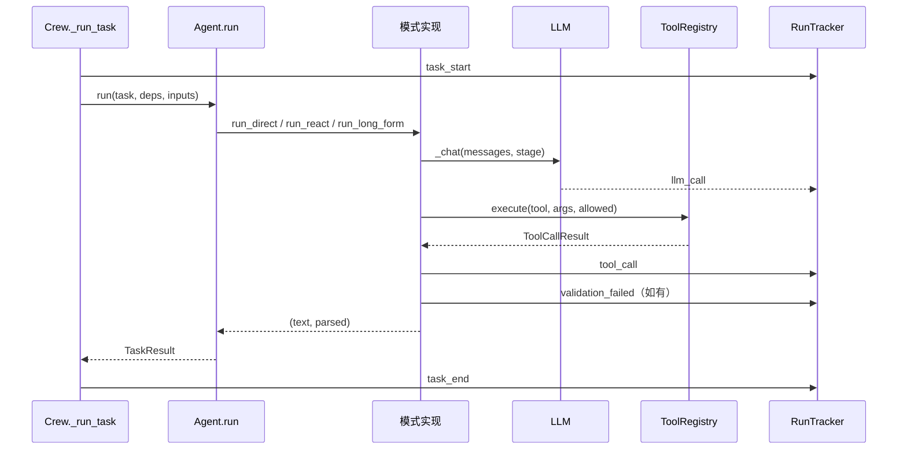

# 02 · 核心运行时（app/core）

本章覆盖编排内核的 10 个模块。它们与具体行业领域无关，可以被看作一个微型 Agent 框架。

```
agent.py ──uses──> llm.py / structured.py / tools.py / tracker.py / prompts.py / schemas.py
crew.py  ──uses──> agent.py / tracker.py / types.py
tools.py ──uses──> search.py / config.py
mock_llm.py ──implements──> llm.BaseLLM
types.py / logging_utils.py 为通用基础设施
```

---

## 1. app/core/types.py — 任务结果

### `TaskResult`（dataclass）

Agent 一次执行的完整快照，是 Task 之间传递的唯一载体。

| 字段 | 类型 | 含义 |
| --- | --- | --- |
| `task_id` / `agent` / `kind` / `title` | `str` | 任务标识与角色 |
| `text` | `str` | 交付物的文本形式（JSON 字符串或 Markdown） |
| `parsed` | `Any` | 结构化交付（`model_dump()` 后的 dict）；Markdown 任务为 `{"chars", "citations"}` |
| `usage` | `dict` | `prompt_tokens / completion_tokens / total_tokens / llm_calls / llm_latency_ms` |
| `tool_calls` | `list[dict]` | 每次工具调用的 `step / tool / ok / duration_ms / args` |
| `validation_retries` | `int` | 校验失败重试次数 |
| `started_at` / `ended_at` / `duration_ms` | | 时间信息 |
| `status` / `error` | `str` | 预留状态字段 |

`to_dict()` 用于序列化（注意：**不包含 `text`**，`text` 单独落盘为报告/证据文件）。

### `CrewResult`（dataclass）

| 字段 | 含义 |
| --- | --- |
| `outputs: dict[str, TaskResult]` | 成功的任务结果，key 为 task id |
| `errors: dict[str, str]` | 失败 / 跳过的任务与原因 |
| `started_at` / `ended_at` / `duration_ms` | 整体时间 |
| `ok`（property） | `not self.errors` |

---

## 2. app/core/llm.py — LLM 抽象层

### 数据结构

```python
@dataclass
class LLMResponse:
    text: str
    prompt_tokens: int = 0
    completion_tokens: int = 0
    model: str = ""
    latency_ms: float = 0.0
    finish_reason: str = ""     # "stop" / "length" / ...
```

### `estimate_tokens(text) -> int`

无 tokenizer 时的估算：CJK 字符按 1 token，其他字符按 1/4 token，最小 1。用于 Mock 模式和 API 未返回 usage 时兜底。

### `BaseLLM`（ABC）

| 成员 | 说明 |
| --- | --- |
| `provider` / `model` | 类属性与实例属性 |
| `chat(messages, *, stage=None, temperature=None, max_tokens=None, json_mode=False)` | 唯一抽象方法，返回 `LLMResponse` |

### `OpenAICompatibleLLM`

- 构造时从 `settings.api_key_env` 读取环境变量；缺失直接抛 `ConfigError`。
- 使用官方 `openai.OpenAI` 客户端，`base_url` 可为空（官方端点）或任意兼容网关。
- `_retryable(exc)`：HTTP 408/409/429/5xx 或消息中含 timeout / connection / rate limit 时可重试。
- `chat()` 行为：
  - 重试次数 = `settings.max_retries + 1`，指数退避 `min(2**attempt, 8)` 秒；
  - `json_mode` 或全局 `settings.json_mode` 时加 `response_format={"type": "json_object"}`；
  - 若模型不支持 `response_format`（报错信息含该字段），自动降级重试一次，不消耗重试次数；
  - `settings.extra_body` 透传（用于智谱 `thinking` 等扩展参数）；
  - `finish_reason == "length"` 时记录 warning，Agent 层据此判定截断。
- 所有异常最终包装为 `LLMError(f"LLM 调用失败（stage=...）")`。

### `create_llm(settings) -> BaseLLM`

```python
if settings.provider == "mock": return MockLLM(settings)
return OpenAICompatibleLLM(settings)
```

> 注意：`build_agents` 会为**每个任务**调用一次 `create_llm`（除非传入共享实例）。Mock 模式无副作用；真实模式会创建多个客户端，但共享同一 `LLMSettings`。

---

## 3. app/core/structured.py — 结构化输出与契约

### `extract_json(text) -> Any`

三层兜底：

1. 优先解析 Markdown 代码块（```json ... ```），从后往前取第一个可解析块；
2. 扫描所有 `{` / `[` 起点，用 `json.JSONDecoder.raw_decode` 解析候选；
3. 取 **序列化后最长** 的候选，避免把 prompt 中的示例小对象误认为交付物。

全部失败抛 `ValueError`。

### `validate_json_output(text, schema) -> (model | None, errors)`

- 调用 `extract_json`；
- 顶层必须是 dict；
- `schema.model_validate(payload)`；
- `ValidationError` 时把前 8 条错误格式化为 `"loc: msg"` 列表。

### `check_markdown(text, *, min_chars=0, required_sections=None, min_citations=0, require_table=False) -> list[str]`

检查项：

| 检查 | 规则 |
| --- | --- |
| 字数 | `len(strip(text)) >= min_chars` |
| 章节 | 每个 `required_sections` 字符串必须出现在正文中 |
| 引用 | 用 `\[E\d+\]` 提取**去重**后的编号数量 ≥ `min_citations` |
| 表格 | 同时存在 `| ... |` 数据行与 `| --- |` 分隔行 |

### `correction_prompt(errors, schema_hint="") -> str`

生成纠错消息：列出错误 + “重新输出完整交付物” + 可选的 kind 级契约提示。

### `count_citations(text) -> int`

返回去重后的 `[E#]` 数量，供报告解析与指标使用。

---

## 4. app/core/agent.py — Agent 运行时

### 4.1 模块级函数

| 函数 | 作用 |
| --- | --- |
| `parse_action(text)` | 从 ReAct 输出解析 `(tool_name, args)`；支持裸 JSON、代码围栏 JSON、以及单必填参数时直接传字符串 |
| `extract_final_answer(text)` | 提取 `Final Answer:` 之后的内容 |
| `_truncation_hint(contract)` | 针对截断场景的压缩重述提示（结构化交付会额外要求 ≤8 条证据、detail ≤120 字） |

ReAct 解析使用三个正则：

```python
_ACTION_RE       = r"^\s*Action\s*[:：]\s*([A-Za-z_][\w\-]*)\s*$"           # 必须独占一行
_ACTION_INPUT_RE = r"Action\s*Input\s*[:：]\s*(.*?)(?=\n\s*(?:Thought|Observation|Action)\s*[:：]|\Z)"
_FINAL_RE        = r"Final\s*Answer\s*[:：]\s*(.*)"
```

> `Action` 行必须独占一行，模型输出 `Action: search_web {"query": ...}` 不会被识别。

### 4.2 `OutputContract`（dataclass）

```python
schema: type[BaseModel] | None   # 来自 SCHEMA_MAP[task.output_schema]
min_chars: int
required_sections: list[str]
min_citations: int
require_table: bool
```

由 `Agent._contract(task)` 根据 `TaskSpec` 组装。

### 4.3 `Agent` 类

构造参数：`spec: AgentSpec`、`llm: BaseLLM`、`registry: ToolRegistry`、`tracker: RunTracker`、`settings: Settings`。

#### 公共入口 `run(task, deps, inputs) -> TaskResult`

1. 重置本轮 `_usage` / `_tool_calls` / `_validation_retries`；
2. 按 `task.mode or spec.mode` 分发：`long_form` / `react` / 其他（direct）；
3. 返回 `TaskResult`（含耗时与开始/结束时间）。

#### `run_direct(...)`

```
for attempt in 0..max_validation_retries:
    response = _chat(messages, stage=task.kind)
    if finish_reason == "length": parsed, errors = None, ["输出因 max_tokens 上限被截断"]
    else: parsed, errors = _validate_output(...)
    if not errors: return text, parsed
    messages += [assistant 原文, user correction_prompt(errors, kind_instruction)]
raise AgentOutputError
```

适合：研究规划、结构化分析、以及任何“一次性交付”的任务。

#### `run_react(...)`

参数额外支持 `messages` 与 `stage`（供研究员补搜复用）。

循环上限：

```python
max_steps = min(spec.max_steps, settings.pipeline.max_react_steps)  # 取正数中的较小值
```

每一步：

1. `finish_reason == "length"` → 注入 `_truncation_hint` 重试（计入 `final_attempts`）。
2. 命中 `Final Answer:` → 校验；失败则纠错重试；成功返回。
3. 命中 `Action:` → 权限校验后执行工具 → 记录 `tool_calls` 与 `tracker.tool_call` → 把 `Observation: ...` 追加到消息。
   - Observation 超过 `settings.pipeline.max_observation_chars`（默认 3000）会被截断并加提示。
4. 既无 Final 也无 Action → 当作最终答案校验（兼容模型直接输出交付物）。
5. 达到步数 / 重试上限 → 追加“强制基于已有 Observation 交付”的用户消息，进入 `#finalize` 阶段再尝试 `max_validation_retries + 1` 次。

任何路径最终失败抛 `AgentOutputError(f"[{task.id}] ReAct 流程未产出合规交付物：...")`。

#### 消息构建

`_base_messages` = `[system, user]`：

- **system**：`build_system_prompt(spec, tools_text=registry.describe(allowed), instruction=kind_instruction(task.kind), react=bool)`
  - ReAct 模式注入工具清单与 ReAct 协议；
  - Direct 模式注入 CoT 协议 + 该 kind 的 JSON 契约。
- **user**：任务标题 + `task.render_description(inputs)`（Jinja2 渲染 `tasks.yaml` 的 description）+ 全局输入（topic / focus / target_chars / today）+ 依赖任务交付物（每个依赖的 `result.text`，超过 `max_dep_chars` 截断）。

#### 工具权限

```python
allowed = set(spec.tools)
if task.tools is not None:
    allowed &= set(task.tools)
```

- `tasks.yaml` 中 `tools: []` 表示**禁用该任务的全部工具**；
- 未写 `tools` 表示沿用角色声明。

#### 校验与统计

| 方法 | 说明 |
| --- | --- |
| `_validate_output(text, contract, task)` | 有 schema → `validate_json_output` 并 `model_dump()`；无 schema → `check_markdown`，返回 `{"chars", "citations"}` |
| `_on_invalid(...)` | 累加 `_validation_retries` 并上报 `tracker.validation_failed` |
| `_chat(...)` | 调用 LLM、累加 usage、上报 `tracker.llm_call`（含 `truncated` 标记） |
| `_structured_call(messages, schema, stage, max_retries)` | 供子类使用的“只要结构化结果”的简版循环（研究员 Coverage 质检使用） |

#### `run_long_form(...)`

基类抛 `NotImplementedError`，由 `WriterAgent` 覆写。

### 4.4 异常类型

- `AgentError(RuntimeError)`：基类。
- `AgentOutputError(AgentError)`：交付物在重试后仍不合规。Crew 捕获后视为任务失败。

---

## 5. app/core/crew.py — Task DAG 调度

### `Crew.__init__(tasks, agents, tracker, *, parallel=True, max_workers=2, max_task_retries=1)`

- `tasks`：`list[TaskSpec]`；`agents`：`dict[task_id, Agent]`（注意 key 是 **task id**，不是角色名）。
- 构造时执行 `_validate()`。

### `_validate()`

1. task id 不得重复；
2. 每个 task 必须绑定 agent；
3. 依赖必须存在且不能自依赖；
4. `_detect_cycle()`：三色标记 DFS，发现环时给出 `a -> b -> a` 路径。

错误类型 `CrewConfigError`。

### `run(inputs) -> CrewResult`

```python
pending = dict(tasks)
while pending:
    blocked = [t for t in pending if any(dep in errors for dep in t.depends_on)]
    # 标记 task_skipped 并删除
    ready = [t for t in pending if all(dep in results for dep in t.depends_on)]
    if not ready: 标记“依赖图无法满足”并退出
    if parallel and len(ready) > 1:  ThreadPoolExecutor(max_workers=min(max_workers, len(ready)))
    else:                            串行执行 ready
    删除已执行的 ready
```

失败处理：`future.result()` / 直接调用抛出的异常写入 `errors[task.id]`，不影响同一轮其他任务。

### `_run_task(task, deps, inputs)`

- 记录 `task_start` / `task_end`（成功与失败都记录）；
- 失败重试 `max_task_retries` 次，每次发 `task_retry` 事件；
- 超限后抛出最后一次异常。

> 重试语义：任务级重试会**重新执行整个 Agent**（包括 LLM 调用与工具调用），与 Agent 内部“校验重试”是两层不同机制。

---

## 6. app/core/tools.py — 工具层

### 数据结构

```python
@dataclass
class Tool:
    name: str
    description: str
    parameters: dict      # JSON Schema
    func: Callable[..., Any]
    def to_prompt(self) -> str

@dataclass
class ToolCallResult:
    name: str
    ok: bool
    output: str = ""
    error: str = ""
    duration_ms: float = 0.0
    args: dict = {}
    def observation(self) -> str   # 成功返回 output，失败返回 "ERROR: ..."
```

### `ToolRegistry`

| 方法 | 说明 |
| --- | --- |
| `register(tool)` | 重名抛 `ValueError` |
| `get(name)` / `names()` | 查询 |
| `describe(allowed=None)` | 生成注入 system prompt 的工具说明 |
| `execute(name, raw_args, allowed=None)` | 权限 → 存在性 → 参数收敛 → 必填校验 → 执行 → JSON 序列化 → 计时 |

参数收敛 `_coerce_args`：

- `dict` 直接使用；
- 字符串先尝试 `json.loads`；
- 不是 JSON 时，若工具只有一个必填参数，则把整段字符串作为该参数值；
- 否则报 `Action Input 必须是 JSON 对象`。

额外安全：执行前会丢弃 schema 未声明的参数（`args = {k:v for k,v in args.items() if k in declared}`）。

**失败不抛异常**，而是返回 `ok=False` 的 `ToolCallResult`，由 Agent 以 Observation 形式喂回模型自愈。

### 工具清单（`build_tool_registry(settings, kb, fetcher=None)`）

| 工具 | 参数 | 返回值（JSON 字符串） | 权限建议 |
| --- | --- | --- | --- |
| `search_web` | `query`, `max_results?` | `query / provider / count / results[{title,url,snippet≤240,published_at}] / note` | researcher |
| `fetch_page` | `url` | `url / title / text(≤max_chars) / provider` | researcher |
| `kb_search` | `query`, `top_k?`, `company?`, `report_year?` | `query / company / report_year / top_k / threshold / count / results[{chunk_id,source,page,company,report_year,score,vector_score,lexical_score,text≤360}] / note`；最多 5 条，避免 Observation 截断；传公司/年份时先过滤候选再排序 | researcher, analyst |
| `calculator` | `expression` | `expression / result` | researcher, analyst |

### `calculate(expression) -> str`

安全表达式求值：`ast.parse(mode="eval")` + 白名单节点遍历。

- 允许：数字常量、`+ - * / // % **`、一元正负、`sqrt/log/log10/exp/abs/round/min/max/pow`、`pi/e`；
- 禁止：变量名（除 pi/e）、属性访问、下标、推导式、任意函数调用、`__import__`。
- 整数结果去小数，其他保留 6 位。

---

## 7. app/core/search.py — 搜索与网页读取

### `SearchProvider`（ABC）

```python
search(query: str, max_results: int) -> list[dict]   # {title,url,snippet,published_at,score?}
```

| 实现 | 说明 |
| --- | --- |
| `FixtureSearch` | 读取 `data/fixtures/search/*.json`；关键词命中数 ×1.5 + bigram 重合度 ×4.0，阈值 0.75；按 URL 去重 |
| `TavilySearch` | POST `https://api.tavily.com/search`；需要 `TAVILY_API_KEY`；返回 snippet 截断 800 |
| `DuckDuckGoSearch` | POST `https://html.duckduckgo.com/html/`；BeautifulSoup 解析 `div.result`；解析 `uddg=` 跳转链接 |
| `FallbackSearch` | 主搜索异常或无结果时回退 fixture，保证演示不中断 |

`build_search_provider(settings, root)` 根据 `search.provider` 选择：

- `fixture` → `FixtureSearch`
- `tavily` → `TavilySearch -> fixture`
- `duckduckgo` → `DuckDuckGoSearch -> fixture`
- `auto` → 有 `TAVILY_API_KEY` 用 Tavily，否则 DuckDuckGo；都带 fixture 兜底

### `extract_main_text(html, max_chars=6000) -> (title, text)`

1. 取 `<title>`；
2. 删除 script/style/noscript/svg/nav/footer/header/aside/form/button；
3. 优先 `article` → `main` → `body`；
4. 抽取 `h1/h2/h3/p/li`，去重、过滤 <12 字符；
5. 若总长 <80，回退全文文本；
6. 截断到 `max_chars`。

### `PageFetcher`

- 离线模式：通过 `data/fixtures/pages/index.json`（URL → 文件名）映射读取本地 HTML；
- 在线模式：`requests.get` + UA 伪装 + `apparent_encoding`；
- 在线失败但 manifest 中存在该 URL → 回退离线页面；否则抛 `FetchError`；
- 正文 <80 字视为“JS 渲染页”，抛错。

---

## 8. app/core/tracker.py — 可观测性

### `RunTracker(run_id, run_dir, *, on_event=None, input_price_per_1k=0.0, output_price_per_1k=0.0)`

- 打开 `run_dir/events.jsonl` 追加写，`threading.RLock` 保护并发（Crew 并行分支会同时写事件）。
- `emit(event_type, **payload)`：写入 `{ts, type, run_id, ...}`，flush，并调用 `on_event` 回调（回调异常被吞掉，不影响主流程）。

### 事件 API

| 方法 | 事件类型 | 关键字段 |
| --- | --- | --- |
| `task_start` | `task_start` | task_id, agent, kind, title |
| `task_end` | `task_end` | duration_ms, status, output_chars, error |
| `llm_call` | `llm_call` | agent, stage, model, prompt/completion tokens, latency_ms, truncated |
| `tool_call` | `tool_call` | agent, stage, tool, args≤300, ok, duration_ms, output_chars, error≤300 |
| `validation_failed` | `validation_failed` | agent, stage, attempt, errors≤8 |
| `coverage` | `coverage_check` | agent, round, sufficient, gaps, followup_queries, reason |
| `run_end` | `run_end` | status, duration_ms |

### `summary()`

聚合维度：

- **全局**：`tokens{prompt,completion,total}`、`cost_usd`、`llm_calls`、`tool_calls`、`tool_failures`、`validation_failures`、`coverage_checks`；
- **按 Agent**（`by_agent`）：token、LLM 调用、LLM 延迟、工具调用/失败、工具延迟、任务耗时、校验失败；
- **按阶段**（`by_stage`）：token、LLM 调用/延迟、工具调用/失败；
- **瓶颈**：`slowest_stages` / `bottlenecks` = 按 `(latency_ms, tokens)` 倒序的 Top-3。

成本计算：`prompt/1000*input_price + completion/1000*output_price`。

`save()` 将 summary 写入 `metrics.json`；`close()` 关闭文件句柄（Windows 下必须调用，否则临时目录可能无法删除）。

---

## 9. app/core/logging_utils.py

- `setup_logging(log_file=None, verbose=False)`：配置 `insight` logger，控制台 + 可选文件双通道；每次调用先清理旧 handler，避免重复输出。
- `shutdown_logging()`：关闭并移除所有 handler。

日志格式：`时间 | 级别 | logger 名 | 消息`。业务 logger 名称：`insight.agent`、`insight.crew`、`insight.llm`、`insight.tools`、`insight.kb`、`insight.pipeline` 等。

---

## 10. app/core/mock_llm.py — 离线模型

`MockLLM` 继承 `BaseLLM`，按 **stage 前缀** 分发到脚本化处理器：

```python
base_stage = stage.split("#")[0]
handlers = {
    "research_plan": _plan,
    "web_research":  _web_research,
    "kb_research":   _kb_research,
    "coverage_check": _coverage,
    "analysis":      _analysis,
    "report_writing": _write_section,
}
```

关键特性：

- **真实调用工具**：`_web_research` 会先输出 `Action: search_web`，等 Observation 回来后再 `fetch_page`，最后输出 `Final Answer`（与真实模型走同一条 ReAct 路径）。
- **确定性**：无随机数、无网络；同样输入产生同样输出。
- **Coverage 两段式**：第一次质检返回 `sufficient=false` + 补搜词，第二次返回 `sufficient=true`，用于验证补搜链路。
- **两种内容模板**：`_nev_*` 针对新能源话题输出完整研报级内容；`_generic_*` 适配任意主题。
- **token 估算**：`estimate_tokens` 计算 prompt/completion，保证指标非零。
- `_observations(messages)` 从消息中倒序提取 `Observation:` 后面的 JSON，供生成证据使用。

> Mock 是“脚本化演示”，不是真正推理；只用于离线跑通与 CI。

---

## 11. 运行时调用关系小结



继续阅读：[03-agents.md](./03-agents.md)
