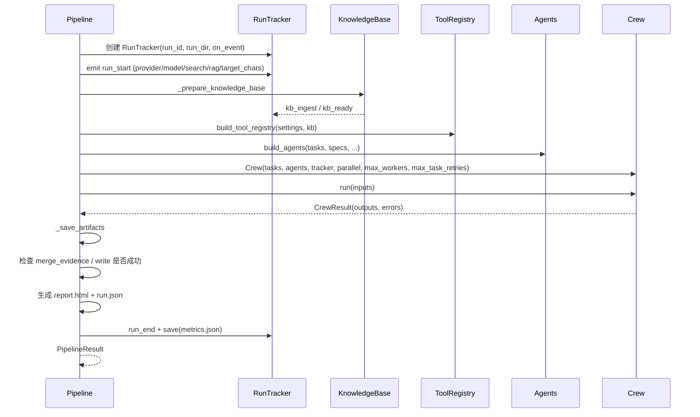
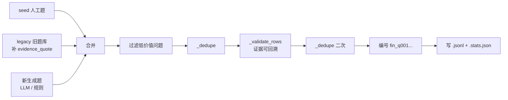

# 05 · 流水线、评测与报告渲染（app/pipeline、app/reporting）

## 1. 端到端编排（pipeline/runner.py）

### 1.1 `PipelineResult`（dataclass）

| 字段 | 说明 |
| --- | --- |
| `run_id` | `YYYYmmdd-HHMMSS-<topic slug>`，slug 最多 24 字符 |
| `run_dir` | `runs/<run_id>/` |
| `topic` | 研究主题 |
| `report` | 最终 Markdown |
| `metrics` | `RunTracker.summary()` |
| `errors` | 失败/跳过的任务 |
| `artifacts` | 产物名 → 路径 |
| `plan` / `evidence` / `analysis` | 结构化结果（可能为 None） |
| `elapsed_ms` / `status` | 总耗时、`ok` / `partial` |
| `ok`（property） | `status == "ok" and bool(report)` |

### 1.2 `ResearchPipeline`

构造时加载：

```python
agent_specs = load_agents(root / "config" / "agents.yaml")
tasks       = load_tasks(root / "config" / "tasks.yaml")
```

### 1.3 `run(topic, focus="", target_chars=None)` 流程



关键细节：

- `run_id` 冲突时复用目录（不会自增），实际使用场景下时间戳精确到秒。
- `inputs` 固定为 `{topic, focus, target_chars, today}`。
- **失败闸门**：
  - `crew_result.errors["merge_evidence"]` 存在 → `PipelineError("证据阶段失败：...")`；
  - `write` 无结果 → `PipelineError("报告任务未完成：...")`。
- 其他任务失败不阻断：只要 `write` 成功，`status = "partial"`。
- 异常路径统一：`tracker.emit("run_error")` → `run_end("error")` → `save()` → `close()` → `shutdown_logging()` → 包装为 `PipelineError`（保留 `run_dir`）。
- 成功路径也会 `tracker.close()` 与 `shutdown_logging()`，避免 Windows 文件占用。

### 1.4 `_prepare_knowledge_base(tracker)`

1. `kb.stats()["chunks"] == 0` 时：
   - 确保 `data/raw` 存在；
   - 若目录为空，调用 `ensure_demo_corpus()` 生成 3 份演示研报；
   - `kb.ingest([raw], reset=True)`；
2. 发出 `kb_ready` 事件；
3. 仍为空则 warning（kb_search 会返回空结果）。

> 因此首次 `run` 会自动 bootstrap，不需要手动建库。

### 1.5 `_save_artifacts(run_dir, outputs, tracker)`

| task id | 文件 |
| --- | --- |
| `plan` | `plan.json` |
| `collect_web` | `evidence_web.json` |
| `collect_kb` | `evidence_kb.json` |
| `merge_evidence` | `evidence.json` |
| `analyze` | `analysis.json` |
| `write` | `report.md` |

- `parsed` 为 dict 时写格式化 JSON，否则写 `text`；
- `events.jsonl` 存在时加入 artifacts；
- 每个产物发 `artifact` 事件。

`report.html` 在 `run()` 中于 artifacts 保存后生成，额外写入 `artifacts["report_html"]`。

### 1.6 `run.json`

```json
{
  "run_id": "...",
  "topic": "...",
  "status": "ok | partial",
  "errors": {...},
  "metrics": {...},
  "artifacts": {...},
  "meta": {
    "topic": "...", "run_id": "...", "generated_at": "...",
    "elapsed_s": 0.0, "chars": 0, "evidence_count": 0, "citations": 0,
    "provider": "mock", "model": "...", "top_k": 5, "threshold": 0.15
  }
}
```

## 2. 评测数据契约（pipeline/eval_schema.py）

### `QAPair`（Pydantic）

```python
id: str
question: str
gold_answer: str
answer_aliases: list[str] = []
evidence_quote: str = ""
source: str = ""
page: int | None = None
category: str = "fact"
difficulty: str = "easy"
answerable: bool = True
requires_calc: bool = False
```

### `normalize_qa_row(row) -> dict`

- 新格式（含 `gold_answer`）：补默认值，保留 `answer_keywords`；
- 旧格式（只有 `answer_keywords`）：把第一个关键词作为 `gold_answer`，其余作为 `answer_aliases`，并保留完整 `answer_keywords`。

评测代码内部统一使用 dict 而非直接模型实例，便于兼容历史数据。

## 3. 检索评测（pipeline/evaluator.py）

### `evaluate_retrieval(kb, qa, top_k_values=(2,4,8), thresholds=(0,0.18,0.3))`

- 只统计 `answerable=True` 的题目（不可回答题不参与检索命中率）；
- 对每个 `(top_k, threshold)` 组合：
  - 逐题 `kb.search(question, top_k, threshold)`；
  - 找到第一个相关切片的位置 `rank`；
  - 命中则 `hits += 1`、`reciprocal_rank += 1/rank`；
  - 未命中记入 `missed`；
- 输出每行：

```json
{
  "top_k": 8, "threshold": 0.15, "questions": 100,
  "skipped_unanswerable": 0, "hits": 97,
  "hit_rate": 0.97, "mrr": 0.8889,
  "avg_latency_ms": 174.41, "missed": ["fin_q019", "fin_q088", "fin_q089"]
}
```

### 相关性判定 `_relevant(row, chunk_text, chunk_source, chunk_page)`

优先级：

1. `evidence_quote` 归一化后，取前 60 / 40 / 24 字，任一前缀出现在切片中即相关；
2. `answer_keywords + answer_aliases + gold_answer` 任一归一化子串出现在切片中；
3. 无 quote、无关键词且有 `source` 时，按来源（与可选页码）匹配。

### `wilson_interval(successes, total, z=1.96)`

Wilson 得分区间，用于给准确率提供 95% 置信区间（小样本比正态近似更稳健）。

### `answer_matches(prediction, row)`

- 不可回答题：预测中是否包含拒答标记（`_REFUSAL_MARKERS`：无法确定/未披露/资料不足/…）；
- 可回答题：
  1. 任一别名（gold / aliases / keywords）归一化后是预测的子串 → 正确；
  2. 否则比较数字集合是否有交集（`_numbers` 支持千分位与小数归一化）；
  3. 都没有 → 错误。

> 这是数值/别名匹配，不是语义判分；开放题应替换为 LLM-as-judge。

### `evaluate_qa(llm, kb, qa, *, top_k=4, threshold=0.15)`

对每题跑两次：

- **闭卷**：system 要求“只输出答案，不确定也给最可能答案，不要以无法确定代替作答”；user 只给问题。
- **RAG**：system 要求“仅根据给定资料回答，资料不足回答无法确定”；user 给 `[i] source p.page + 切片文本` 与问题。

输出：

| 字段 | 含义 |
| --- | --- |
| `closed_book_accuracy` / `rag_accuracy` | 总体准确率 |
| `delta_pp` | RAG − 闭卷（百分点） |
| `closed_book_answerable_accuracy` / `rag_answerable_accuracy` | 可回答题准确率 |
| `rag_refusal_accuracy` | 不可回答题拒答率 |
| `closed_book_ci95` / `rag_ci95` | Wilson 95% CI |
| `by_category` | 每个 category 的 n / 闭卷 / RAG 准确率 |
| `details` | 逐题明细（问题、gold、两个预测、是否正确、检索条数） |

评测口径：同模型、temperature 由 LLMSettings 控制（脚本未显式传 0，建议在配置中设 0）、同一套 prompt。

RAG 检索会传入该题的 `company` / `report_year` 做元数据过滤；闭卷与 RAG 的 user prompt 都使用补全后的自包含问题，因此闭卷也能看到公司/年份，这会让闭卷基线比旧版略高，跨版本比较时需注意。

100 题实测（GLM 配置）：闭卷 14% → RAG **90%**（+76pp，CI 82.6%–94.5%）；未补全/未过滤的历史结果为 10% → 84%。剩余错误主要是表格行列错位、PDF 乱码和单位判分。

## 4. 评测集构建（pipeline/qa_builder.py）

### 4.1 两种模式

| 模式 | 触发条件 | 行为 |
| --- | --- | --- |
| LLM 生成 | 传入 `llm` | 逐切片让模型生成 grounded QA，校验 `evidence_quote` 是原文子串 |
| 规则抽取 | `llm=None` | 基于正则/关键词从句子与表格中抽取事实 |

### 4.2 切片选择 `_select_chunks(chunks, max_chunks, sample)`

- 先按 `VALUABLE_CHUNK_RE` 过滤有业务价值的切片（营收/利润/毛利率/销量/份额/增速/机器人/…）；
- 同时排除 `LOW_VALUE_CHUNK_RE`（监事会/董事会决议/审计报告/财务报表附注等）；
- 高质量切片不足 `max_chunks` 时回退全量；
- 采样方式：
  - `head`：前 N 个；
  - `random`：固定种子 `20261115` 随机采样（可复现）；
  - `stratified`：按 `source` 分层，按比例配额并等距抽取（`_evenly_spaced`）。

### 4.3 规则抽取 `heuristic_candidates()`

- 表格行：首列是已知公司名、第二列是百分比 → 生成份额题；
- 句子规则（按顺序匹配，第一条命中即返回）：
  - CAGR / 复合增长率 → 复合增长率题
  - 免税额 / 减税额 → 政策上限题
  - 关税 → 最高关税题
  - 私人充电桩 / 充电基础设施 / 公共充电桩 → 数量或同比题
  - 2025 + 销量 + 增速区间 → 预测区间题
  - 装机量 → 动力电池装机量题
  - 市占率 / 份额 + 公司 → 份额题
  - 毛利率 / 利润率 → 毛利率题
  - 渗透率 → 渗透率题
  - 出口 → 出口量或增速题
  - 销量 → 销量或同比题
- 每条题都带 `evidence_quote`（原句截断 240 字）、`source`、`page`、`company`、`report_year`。

### 4.4 题目补全公司/年份 `ground_row()`

四家年报的“研发投入/净利润/现金流”等科目措辞高度相似，原始题目大量使用“公司”且不含公司名，容易跨公司混检。构建阶段统一补全：

- 埃斯顿/拓斯达/汇川技术/新时达年报 → 前缀“在{公司}2024年年报中，”；
- 两份 IFR 报告 → 前缀“根据IFR《World Robotics {2024|2025}》执行摘要，”；
- 去掉与报告年份重复的开头年份，避免“2024年年报中，2024年…”；
- 写入 `company`、`report_year`、`report_name` 元数据，供检索过滤使用；
- 不可回答题无 source，保持原样。

> 补全后的题干用于 LLM 阅读；检索侧由 `company` / `report_year` 元数据过滤承担公司选择，并用 `strip_report_context()` 去掉前缀后再排序。实测 100 题：原始题目 93% / 0.8201，补全但不过滤 88% / 0.7416，过滤后 **97% / 0.8889**。501 题是题库总量（493 可答 + 8 不可答），全量 501 的 `97.16% / 0.884` 为历史运行、产物未保留，文档统一使用 100 题数字。

### 4.5 LLM 生成 `_llm_candidates()`

Prompt 约束：

- 每切片最多 `per_chunk` 题；
- 问题不能包含答案；
- `evidence_quote` 必须逐字出现在片段中；
- 禁止目录/页码/公司全称/网址/会计师事务所/保荐机构等低价值题；
- 只针对业务与经营数据。

校验：

```python
if _normalize(quote[:40]) not in _normalize(chunk.text): 丢弃
```

### 4.6 后处理流水线



- 低价值问题过滤：`LOW_VALUE_QUESTION_RE`（目录/封面/页码/网址/会计师事务所/证券代码/法定代表人/联系方式…）。
- 去重 `_dedupe()`：
  - 问题 key：去掉空白、标点与“是多少/多少/的/请问/根据/研报/数据显示”；
  - 数值答案：同一 category 下数字集合互为子集视为重复；
  - 文本答案：`(归一化答案, category)` 相同视为重复。
- 校验 `_validate_rows()`：
  - 不可回答题直接保留；
  - 有 `evidence_quote` 且能在某个切片中找到前 40 字 → 保留；
  - 否则按答案数字反查句子补 `evidence_quote`；
  - 都失败 → 丢弃并 warning。
- 不可回答题：内置 8 条 `UNANSWERABLE`（机器人行业），可在 `--no-unanswerable` 下关闭。
- 最终写入：
  - `out_path`（JSONL，一行一题）；
  - 同名 `.stats.json`（总数、可回答/不可回答、有证据数、分类与难度分布、生成器、切片数、路径）。

### 4.7 `build_eval_set(...)` 参数

| 参数 | 默认 | 说明 |
| --- | --- | --- |
| `per_chunk` | 3 | 每切片最多生成题数 |
| `max_chunks` | 30 | 采样切片上限 |
| `sample` | `head` | `head` / `random` / `stratified` |
| `seed_path` | None | 人工种子题 |
| `legacy_path` | None | 旧题库（自动补证据） |
| `include_unanswerable` | True | 是否加入不可回答题 |
| `out_path` | None | 输出路径 |

## 5. HTML 报告渲染（reporting/renderer.py）

`render_report_html(report_md, meta, metrics, evidence) -> str`：

1. `markdown.markdown(..., extensions=["tables", "fenced_code", "toc", "sane_lists"])` 转 HTML；
2. 用 `Jinja2 Environment` 加载同目录 `report_template.html`（`autoescape` 仅 html）；
3. 传入模板变量：
   - `topic / run_id / generated_at / elapsed_s / chars / citations / evidence_count`
   - `provider / model / top_k / threshold`
   - `body_html`
   - `stage_rows`：`by_stage` 转 `{stage, calls, tokens, latency}`，按延迟倒序
   - `total_tokens / cost_usd / llm_calls / tool_calls`
   - `evidence_items`：证据前 12 条
4. 返回自包含 HTML（CSS 内联在模板中，无外部资源）。

## 6. 评测工作流（推荐）

```powershell
# 1) 构建/更新索引
python -m app.cli bootstrap

# 2) 构建评测集（离线规则抽取；输出可按需调整）
python -m app.cli build-eval --provider mock --per-chunk 4 --out data/eval/qa_private.jsonl

# 3) 扫描检索参数（无需 API Key；当前主用机器人行业 501 题题库，取前 100 题对照）
python -m app.cli eval --qa-file data/eval/qa_robotics_v2.jsonl --limit 100 `
  --top-k 8 --thresholds 0.15

# 4) 真实模型闭卷 vs RAG
python -m app.cli eval --qa-file data/eval/qa_robotics_v2.jsonl --limit 100 `
  --provider zhipu --with-qa --top-k 8 --thresholds 0.15
```

结果写入 `runs/eval_results.json`，包含 `retrieval`、`qa_set`、`kb` 与可选 `qa` 四部分。

## 7. 产物与指标速查

| 文件 | 何时产生 | 关键内容 |
| --- | --- | --- |
| `plan.json` | plan 成功 | 研究规划 |
| `evidence_web.json` / `evidence_kb.json` | 两路检索成功 | 原始证据 |
| `evidence.json` | merge 成功 | 统一编号证据 |
| `analysis.json` | analyze 成功 | 结构化分析 |
| `report.md` | write 成功 | 报告正文 |
| `report.html` | 运行结束 | 自包含 HTML |
| `metrics.json` | 运行结束/异常 | Token、成本、耗时、瓶颈、按 Agent/阶段 |
| `events.jsonl` | 实时 | 逐事件 |
| `run.json` | 运行结束 | 元信息与产物索引 |
| `run.log` | 实时 | 日志 |
| `runs/eval_results.json` | eval 命令 | 评测结果 |

继续阅读：[06-config-and-interfaces.md](./06-config-and-interfaces.md)
