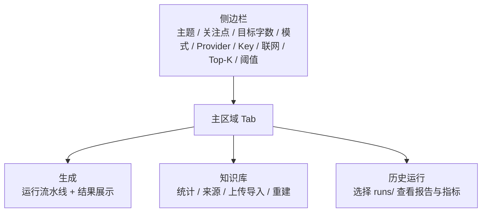

# 06 · 配置与接入接口（config、CLI、Streamlit、示例语料）

## 1. 配置系统（app/config.py）

### 1.1 三层配置

| 层 | 文件 / 来源 | 作用 |
| --- | --- | --- |
| 运行参数 | `config/settings.yaml` + `.env` + CLI/UI 覆盖 | LLM、RAG、搜索、抓取、流水线、成本 |
| 角色 | `config/agents.yaml` | role / goal / backstory / tools / mode / max_steps / temperature |
| 任务 | `config/tasks.yaml` | id / agent / kind / depends_on / tools / output_schema / 交付契约 / description 模板 |

### 1.2 配置优先级（从低到高）

```
dataclass 默认值
  < config/settings.yaml
  < .env（只覆盖 INSIGHT_PROVIDER / INSIGHT_MODEL / INSIGHT_BASE_URL / INSIGHT_API_KEY_ENV）
  < CLI 参数 / Streamlit 侧边栏
```

`Settings.from_file()` 会先 `load_dotenv(ROOT/.env, override=False)`，因此已存在的系统环境变量优先于 `.env`。

### 1.3 配置数据类

| 类 | 关键字段 |
| --- | --- |
| `LLMSettings` | provider, model, base_url, api_key_env, extra_body, temperature, max_tokens, timeout, max_retries, json_mode |
| `RAGSettings` | backend, embedding, embedding_model, embedding_api_key_env, embedding_base_url, dim, chunk_size, chunk_overlap, top_k, score_threshold, persist_dir, chroma_dir, collection |
| `SearchSettings` | provider, max_results, timeout, fixture_dir, tavily_api_key_env |
| `FetchSettings` | offline, timeout, max_chars, fixture_dir |
| `PipelineSettings` | max_react_steps, max_coverage_rounds, max_validation_retries, max_task_retries, target_chars, parallel, max_workers, output_dir, max_dep_chars, max_observation_chars |
| `ObservabilitySettings` | input_price_per_1k, output_price_per_1k |
| `Settings` | root + 上述各节，方法 `from_file / with_overrides / path / api_key / require_api_key` |

### 1.4 Provider 预设

```python
PROVIDER_PRESETS = {
  "mock":     {model: "mock-researcher",  base_url: None, api_key_env: "OPENAI_API_KEY"},
  "openai":   {model: "gpt-4o-mini",      base_url: None, api_key_env: "OPENAI_API_KEY"},
  "deepseek": {model: "deepseek-chat",    base_url: "https://api.deepseek.com/v1",              api_key_env: "DEEPSEEK_API_KEY"},
  "qwen":     {model: "qwen-plus",        base_url: "https://dashscope.aliyuncs.com/compatible-mode/v1", api_key_env: "DASHSCOPE_API_KEY"},
  "moonshot": {model: "moonshot-v1-8k",   base_url: "https://api.moonshot.cn/v1",              api_key_env: "MOONSHOT_API_KEY"},
  "zhipu":    {model: "glm-4.6",          base_url: "https://open.bigmodel.cn/api/paas/v4/",   api_key_env: "ZHIPU_API_KEY",
               extra_body: {"thinking": {"type": "disabled"}}},
}
```

`LLMSettings.__post_init__()`：

- 未知 provider → `ConfigError`；
- 空 model / base_url / api_key_env 用预设补齐；
- 智谱 `glm-5.x` 不支持 `thinking.disabled`，自动降级为 `enabled + effort=low`。

### 1.5 `with_overrides()`

```python
settings.with_overrides(llm=..., rag=..., search=..., fetch=..., pipeline=...)
```

两个重要的“清空继承”规则：

- 切换 provider → 清空 `base_url / api_key_env / extra_body`，避免沿用上一家的端点与 Key；
- 切换 model → 清空 `extra_body`，避免模型专属参数串味。

### 1.6 路径与密钥

- `settings.path(value)`：相对路径基于项目根目录解析；
- `settings.api_key()`：读取 `llm.api_key_env` 指向的环境变量，空串返回 None；
- `settings.require_api_key()`：缺失时抛 `ConfigError` 并提示改用 `mock`。

### 1.7 YAML 加载

`load_agents(path)`：

- 只接受白名单字段；
- 必须包含 `role` 与 `goal`；
- 返回 `dict[key, AgentSpec]`。

`load_tasks(path)`：

- 从 `tasks:` 列表逐项构造 `TaskSpec`；
- `id / agent / kind` 必填；
- `tools=None` 表示沿用角色，`tools=[]` 表示禁用；
- 空任务列表抛 `ConfigError`。

---

## 2. 配置文件示例

### `config/settings.yaml`（有效值）

```yaml
llm:   { provider: mock, model: "", max_tokens: 8192, temperature: 0.3 }
rag:   { backend: local, embedding: zhipu, embedding_model: embedding-3,
         embedding_api_key_env: ZHIPU_API_KEY, embedding_base_url: null, dim: 2048,
         chunk_size: 900, chunk_overlap: 150, top_k: 5, score_threshold: 0.15 }
search:{ provider: fixture, max_results: 5 }
fetch: { offline: true, max_chars: 4000 }
pipeline: { max_react_steps: 7, max_coverage_rounds: 2,
            max_validation_retries: 2, max_task_retries: 1,
            target_chars: 8000, parallel: true, max_workers: 2,
            max_dep_chars: 20000, max_observation_chars: 3000 }
observability: { input_price_per_1k: 0.00015, output_price_per_1k: 0.0006 }
```

### `config/agents.yaml`

```yaml
researcher:
  role: 资深行业研究员
  goal: 拆解问题、多轮检索、收集可溯源事实
  backstory: ...
  tools: [search_web, fetch_page, kb_search, calculator]
  mode: react
  max_steps: 7
  temperature: 0.2
```

新增角色后必须在 `app/agents/factory.py` 的 `_agent_class` 中注册对应实现，否则会回退到基类 `Agent`。

### `config/tasks.yaml`

```yaml
tasks:
  - id: write
    agent: writer
    kind: report_writing
    depends_on: [plan, merge_evidence, analyze]
    tools: []
    mode: long_form
    min_chars: 4000
    min_citations: 6
    require_table: true
    required_sections: [核心摘要, 市场规模, 竞争格局, 产业链, 趋势, 风险, 结论]
    description: |
      ## 研究主题
      {{ topic }}
      ...
```

- `description` 是 Jinja2 模板，可用变量 `topic / focus / target_chars / today`；
- `output_schema` 必须是 `SCHEMA_MAP` 中的名字；
- `coverage_check: true` 仅研究员联网任务使用；
- `min_citations` 在写作阶段会被 `min(min_citations, 证据数)` 动态下调。

---

## 3. 环境变量（.env）

| 变量 | 用途 |
| --- | --- |
| `INSIGHT_PROVIDER` / `INSIGHT_MODEL` / `INSIGHT_BASE_URL` / `INSIGHT_API_KEY_ENV` | 覆盖 llm 配置 |
| `DEEPSEEK_API_KEY` / `OPENAI_API_KEY` / `DASHSCOPE_API_KEY` / `MOONSHOT_API_KEY` / `ZHIPU_API_KEY` | 各 Provider Key；`ZHIPU_API_KEY` 同时用于默认的 GLM `embedding-3` |
| `TAVILY_API_KEY` | Tavily 搜索；缺省时 `auto` 回退 DuckDuckGo |
| `OPENAI_BASE_URL` | `rag.embedding=openai` 时的可选网关 |

> 默认 `rag.embedding: zhipu` 需要 `ZHIPU_API_KEY`；`demo` 会强制切到离线 `hashing` + `data/index_demo`，因此不需要 Key。若要完全离线运行 `run`/`eval`，把 `rag.embedding` 改为 `hashing`、`dim: 768` 后重建索引。

`INSIGHT_BASE_URL` + `INSIGHT_API_KEY_ENV` 可以让任意 OpenAI 兼容网关接入，无需改代码。

---

## 4. CLI 命令参考（app/cli.py）

入口：`python -m app.cli <command>`，`prog="insight"`。

### 4.1 命令总览

| 命令 | 作用 | 主要参数 |
| --- | --- | --- |
| `bootstrap` | 生成演示研报并重建知识库（`reset=True`） | 无 |
| `ingest` | 解析并增量入库 | `paths...`、`--reset` |
| `run` | 运行完整研究流水线 | 见下表 |
| `demo` | 离线一键演示（Mock + fixtures） | `--topic`、`--target-chars`（默认 8000） |
| `eval` | 检索评测 + 可选问答评测 | 见下表 |
| `build-eval` | 从知识库构建评测集 | 见下表 |
| `ui` | 启动 Streamlit | `--port`（8501）、`--headless` |

### 4.2 `run` 参数

| 参数 | 说明 |
| --- | --- |
| `--topic`（必填） | 研究主题 |
| `--focus` | 用户关注点 |
| `--provider` | mock / openai / deepseek / qwen / moonshot / zhipu |
| `--thinking` | disabled / low / high / max（智谱 glm-5.x 不支持 disabled） |
| `--model` | 覆盖模型名 |
| `--online` | 真实联网检索与网页抓取（`search.provider=auto`、`fetch.offline=False`） |
| `--top-k` | RAG Top-K |
| `--threshold` | RAG 相似度阈值 |
| `--target-chars` | 目标字数 |
| `--output-dir` | 产物目录 |

### 4.3 `eval` 参数

| 参数 | 默认 | 说明 |
| --- | --- | --- |
| `--qa-file` | `data/eval/qa.jsonl` | 评测集 JSONL |
| `--top-k` | `2 4 8` | 可传多个值扫描 |
| `--thresholds` | `0.0 0.18 0.3` | 可传多个值扫描 |
| `--with-qa` | 关闭 | 使用真实 LLM 跑闭卷/RAG（Mock 下自动跳过） |
| `--provider` / `--thinking` / `--model` | | 模型选择 |
| `--limit` | 无 | 只评测前 N 题 |

### 4.4 `build-eval` 参数

| 参数 | 默认 | 说明 |
| --- | --- | --- |
| `--per-chunk` | 3 | 每切片最多生成题数 |
| `--max-chunks` | 30 | 采样切片上限 |
| `--sample` | `head` | `head` / `random` / `stratified` |
| `--out` | `data/eval/qa_v2.jsonl` | 输出文件 |
| `--no-legacy` | | 不合并旧 `qa.jsonl` |
| `--no-seed` | | 不合并人工种子题 |
| `--no-unanswerable` | | 不加入不可回答题 |

### 4.5 覆盖逻辑 `_build_settings(args)`

```python
settings = Settings.from_file(ROOT / "config" / "settings.yaml")
# provider 优先；只改 model 时不清空 provider
# --thinking 映射到 extra_body.thinking 与 reasoning_effort
# --top-k / --threshold → rag
# --online → search.provider=auto + fetch.offline=False
# --target-chars / --output-dir → pipeline
return settings.with_overrides(...)
```

### 4.6 `ConsoleProgress`

实现 `on_event(event)` 回调，把事件打印为人类可读行：

| 事件 | 输出 |
| --- | --- |
| `task_start` | `[task] id · title (agent)` |
| `task_end` | `[done|FAIL] id · 1.23s` |
| `tool_call` | `[tool] name (ok|err, 12ms)` |
| `coverage_check` | `[coverage] round 1 -> insufficient` |
| `validation_failed` | `[retry] stage 校验失败：...` |
| `task_retry` | `[retry] id 第 N 次重试` |
| `kb_ingest` / `kb_ready` | 入库与就绪信息 |
| `run_summary` | `[run] status · 12.3s` |

### 4.7 退出码

| 场景 | 退出码 |
| --- | --- |
| 成功 | 0 |
| 流水线失败 / `PipelineResult.ok == False` | 1 |
| `ConfigError`（main 捕获） | 2 |
| Streamlit 未安装（`ui`） | 1 |

---

## 5. Streamlit 前端（app/ui/streamlit_app.py）

### 5.1 页面结构



### 5.2 生成页

- 运行模式：`离线演示（Mock）` 或 `真实模型`；
- 真实模型下可选 Provider（`PROVIDER_ENV` 的 key 顺序：deepseek / openai / qwen / moonshot / zhipu），Key 可临时输入（仅存当前会话内存，写入 `os.environ`）；
- 覆盖项：

```python
overrides = {
  "llm": {"provider": ..., "model": ...},
  "rag": {"top_k": ..., "score_threshold": ...},
  "pipeline": {"target_chars": ...},
  "search": {"provider": "auto" | "fixture"},
  "fetch": {"offline": False | True},
}
```

- 运行事件通过 `on_event` 实时显示最近 12 行；
- 结果用 5 个指标卡（字数、证据、Token、LLM 调用、成本）+ 5 个页签（报告 / 结构化分析 / 证据链 / 运行指标 / 事件日志）；
- 提供下载：`report.md`、`report.html`、`metrics.json`；
- 结果保存在 `st.session_state["result"]`，切换页签不丢失。

### 5.3 知识库页

- 展示状态、切片数、文档数、后端、Embedding；
- `kb.list_sources()` 表格；
- 上传 PDF/DOCX/MD/TXT → 写入 `data/uploads/` → `kb.ingest(paths)` 增量入库；
- “用 data/raw 重建索引” → `ensure_demo_corpus()` + `kb.ingest([raw], reset=True)`。

### 5.4 历史运行页

- 扫描 `runs/*/report.md`，按 mtime 倒序；
- 左侧渲染报告，右侧下载 + 总 Token / LLM 调用 / 工具调用 / 慢阶段 Top-3。

### 5.5 前端注意事项

- `ROOT = Path(__file__).resolve().parents[2]` 并插入 `sys.path`，因此必须从项目根启动；
- 前端不做并发任务队列、登录与权限控制，属于单机演示界面；
- `st.session_state` 只保存最后一次结果。

---

## 6. 示例语料生成（app/sample_data.py）

`ensure_demo_corpus(root) -> list[Path]`：

- 目标文件（存在则跳过）：
  - `data/raw/nev_2024_industry_report.pdf`
  - `data/raw/nev_2024_competition.docx`
  - `data/raw/nev_policy_risk.md`
- PDF：`reportlab` 生成，注册中文字体（`msyh.ttc` / `simsun.ttc`，失败回退 `STSong-Light`），包含标题、正文段落与关键指标表；
- DOCX：`python-docx` 生成，含两个表格（整车份额、电池份额）；
- Markdown：政策、需求、风险、充电、数据表、口径说明。

> 数据全部为**合成演示数据**，仅用于验证工程实现，不构成研究结论。

---

## 7. 数据目录

```
data/
├── raw/             # 研报（gitignore 掉 pdf/docx/md/txt）
│   └── robotics/    # 机器人行业研报（当前仓库已有）
├── fixtures/
│   ├── search/      # 离线搜索：nev_battery/charging/competition/market/outlook/policy.json
│   └── pages/       # 离线网页：index.json 映射 + 7 个 html
├── eval/            # qa.jsonl / qa_seed.jsonl / qa_v2.jsonl（61 题）/ qa_robotics_v2.jsonl（501 题）+ stats
├── index/           # LocalVectorStore 持久化（gitignore）
├── chroma/          # Chroma（gitignore，按需）
└── uploads/         # Streamlit 上传临时目录（gitignore）
```

继续阅读：[07-dependencies.md](./07-dependencies.md)
