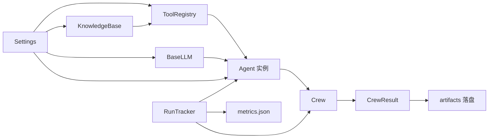

# 07 · 依赖关系与分层约束

## 1. 内部模块依赖图

箭头方向：`A --> B` 表示 A 导入 B。

```mermaid
flowchart TB
    subgraph 接入
        CLI["app/cli.py"]
        UI["app/ui/streamlit_app.py"]
    end
    subgraph 流水线
        Runner["app/pipeline/runner.py"]
        Evaluator["app/pipeline/evaluator.py"]
        QABuilder["app/pipeline/qa_builder.py"]
        EvalSchema["app/pipeline/eval_schema.py"]
    end
    subgraph Agent
        Factory["app/agents/factory.py"]
        Researcher["app/agents/researcher.py"]
        Analyst["app/agents/analyst.py"]
        Merger["app/agents/merger.py"]
        Writer["app/agents/writer.py"]
        Prompts["app/agents/prompts.py"]
    end
    subgraph 核心
        Agent["app/core/agent.py"]
        Crew["app/core/crew.py"]
        LLM["app/core/llm.py"]
        Mock["app/core/mock_llm.py"]
        Tools["app/core/tools.py"]
        Search["app/core/search.py"]
        Structured["app/core/structured.py"]
        Tracker["app/core/tracker.py"]
        Types["app/core/types.py"]
        Logging["app/core/logging_utils.py"]
    end
    subgraph RAG
        KB["app/rag/knowledge.py"]
        Store["app/rag/store.py"]
        Emb["app/rag/embeddings.py"]
        Loaders["app/rag/loaders.py"]
        Splitter["app/rag/splitter.py"]
        RagModels["app/rag/models.py"]
    end
    subgraph 其他
        Config["app/config.py"]
        Schemas["app/schemas.py"]
        Renderer["app/reporting/renderer.py"]
        Sample["app/sample_data.py"]
    end

    CLI --> Runner
    CLI --> Evaluator
    CLI --> KB
    CLI --> LLM
    UI --> Runner
    UI --> KB

    Runner --> Factory
    Runner --> Crew
    Runner --> Tools
    Runner --> Tracker
    Runner --> KB
    Runner --> Renderer
    Runner --> Config

    Evaluator --> EvalSchema
    Evaluator --> KB
    Evaluator --> LLM
    QABuilder --> EvalSchema
    QABuilder --> KB
    QABuilder --> RagModels
    QABuilder --> LLM
    QABuilder --> Structured

    Factory --> Researcher & Analyst & Merger & Writer
    Factory --> Agent
    Factory --> LLM
    Factory --> Tools
    Researcher --> Agent & Prompts & Schemas
    Analyst --> Agent
    Merger --> Agent & Schemas
    Writer --> Agent & Prompts & Structured & Schemas

    Agent --> Crew_Tracker["Tracker"]
    Agent --> Tools
    Agent --> LLM
    Agent --> Structured
    Agent --> Prompts
    Agent --> Schemas
    Agent --> Config
    Crew --> Types
    Crew --> Tracker
    Crew --> Agent
    LLM --> Config
    Mock --> LLM
    Mock --> Structured
    Tools --> Search
    Tools --> Config
    Search --> Config
    Structured --> Schemas

    KB --> Store
    KB --> Emb
    KB --> Loaders
    KB --> Splitter
    KB --> RagModels
    Store --> RagModels
    Loaders --> RagModels
    Emb --> Config

    Renderer --> Config
    Prompts --> Config
    Schemas --> Config
    Runner --> Sample
    UI --> Sample

    Runner --> Schemas
    Runner --> Types
```

> 图中 `Crew_Tracker` 仅为避免与 `Crew` 节点重名，实际就是 `app/core/tracker.py`。

## 2. 分层依赖规则

| 层 | 允许依赖 | 禁止依赖 |
| --- | --- | --- |
| `app/schemas.py` | 仅标准库 + pydantic | 任何 `app.*` 业务模块 |
| `app/config.py` | 标准库 + yaml/dotenv/jinja2 | `app.core`、`app.agents`、`app.rag`、`app.pipeline` |
| `app/core/*` | `config`、`schemas`、同层模块 | `agents`、`pipeline`、`rag`（`tools.py` 通过鸭子类型接收 `kb`，不 import `KnowledgeBase`） |
| `app/agents/*` | `core`、`config`、`schemas`、`prompts` | `pipeline`、`rag`（不得直接访问向量库） |
| `app/rag/*` | `config`、`rag.models`、第三方 | `core`、`agents`、`pipeline` |
| `app/pipeline/*` | 所有下层 | UI / CLI |
| `app/cli.py`、`app/ui/*` | 所有下层 | 不反向被依赖 |

**两条特别约束**

1. `app/core/tools.py` 对知识库只使用鸭子类型（`kb.search(...)`、`result.chunk.*`），因此测试里可以用 `FakeKB` 注入，不需要拉起真实索引。
2. `app/core/agent.py` 只依赖 `SCHEMA_MAP` 选择校验模型，不 import 任何具体 Agent 子类，避免循环依赖。

## 3. 关键导入清单

| 模块 | 关键导入 |
| --- | --- |
| `app/cli.py` | config, core.llm, core.logging_utils, pipeline.evaluator, pipeline.runner, rag.knowledge；`sample_data`、`qa_builder` 为函数内延迟导入 |
| `app/config.py` | `yaml`, `dotenv.load_dotenv`, `jinja2.Template` |
| `app/core/agent.py` | `pydantic.BaseModel`, agents.prompts, config, core.llm, core.structured, core.tools, core.tracker, core.types, schemas |
| `app/core/crew.py` | config, core.agent (类型), core.tracker, core.types |
| `app/core/llm.py` | config；`mock_llm` 在 `create_llm` 内延迟导入；`openai` 在构造函数内延迟导入 |
| `app/core/tools.py` | config, core.search |
| `app/core/search.py` | config, `requests`, `bs4` |
| `app/core/tracker.py` | 仅标准库（json / threading / time / collections / datetime / pathlib） |
| `app/core/structured.py` | `pydantic` |
| `app/rag/loaders.py` | `models`；`pypdf` / `docx` 在函数内延迟导入 |
| `app/rag/splitter.py` | 尝试 `langchain_text_splitters`，失败则本地实现 |
| `app/rag/embeddings.py` | config, `numpy`；`openai` 延迟导入（GLM / OpenAI 共用） |
| `app/rag/store.py` | config, `numpy`；`chromadb` 延迟导入 |
| `app/pipeline/runner.py` | agents.factory, config, core.crew, core.logging_utils, core.tools, core.tracker, rag.knowledge, reporting.renderer；`sample_data` 延迟导入 |
| `app/pipeline/evaluator.py` | core.llm (BaseLLM 类型), eval_schema, rag.knowledge |
| `app/pipeline/qa_builder.py` | core.llm, core.structured, eval_schema, rag.knowledge, rag.models |
| `app/reporting/renderer.py` | `markdown`, `jinja2` |
| `app/ui/streamlit_app.py` | `streamlit`, `pandas`, config, pipeline.runner, rag.knowledge；`sample_data` 延迟导入 |
| `app/sample_data.py` | `reportlab`、`python-docx` 均在函数内延迟导入 |

## 4. 第三方依赖（requirements.txt）

| 包 | 用途 | 使用位置 |
| --- | --- | --- |
| `pydantic>=2.5` | 数据契约与校验 | `schemas.py`、`structured.py`、`eval_schema.py` |
| `PyYAML>=6.0` | 读取 settings / agents / tasks | `config.py` |
| `python-dotenv>=1.0` | 加载 `.env` | `config.py` |
| `requests>=2.28` | Tavily / DDG / 网页抓取 | `core/search.py` |
| `httpx>=0.27` | OpenAI SDK 的 HTTP 传输（间接依赖） | 无直接 import |
| `beautifulsoup4>=4.11` | 搜索结果与网页正文解析 | `core/search.py` |
| `pypdf>=4.0` | PDF 逐页文本抽取 | `rag/loaders.py` |
| `python-docx>=1.1` | DOCX 段落与表格解析 | `rag/loaders.py`、`sample_data.py` |
| `numpy>=1.24` | Embedding 与向量检索 | `rag/embeddings.py`、`rag/store.py` |
| `pandas>=2.0` | Streamlit 表格与图表 | `ui/streamlit_app.py` |
| `jinja2>=3.1` | 任务描述模板 + HTML 模板 | `config.py`、`reporting/renderer.py` |
| `openai>=1.30` | OpenAI 兼容 LLM 与 Embedding | `core/llm.py`、`rag/embeddings.py` |
| `tenacity>=8.2` | 已声明但当前源码未直接使用（重试由 `OpenAICompatibleLLM` 自行实现） | — |
| `markdown>=3.5` | Markdown → HTML | `reporting/renderer.py` |
| `langchain-text-splitters>=0.2` | 可选切片实现（缺失时自动回退本地实现） | `rag/splitter.py` |
| `streamlit>=1.33` | Web 前端 | `ui/streamlit_app.py`、`cli.cmd_ui` |
| `reportlab>=4.0` | 生成演示 PDF 研报 | `sample_data.py` |

## 5. 可选依赖（requirements-optional.txt）

| 包 | 用途 | 缺失时行为 |
| --- | --- | --- |
| `chromadb>=0.5` | 向量库后端 | `rag.backend=chroma` 时抛 `RuntimeError` 并提示安装；默认 `local` 不受影响 |

## 6. 可选能力与降级矩阵

| 能力 | 缺失 / 失败时 | 代码位置 |
| --- | --- | --- |
| LangChain 切片器 | 使用本地等价递归实现 | `rag/splitter.py` |
| `openai` SDK | `LLMError`（提示 pip install） | `core/llm.py` |
| `pypdf` / `python-docx` | 对应文件解析失败，计入 `skipped_files` | `rag/loaders.py` |
| `chromadb` | RuntimeError（仅 chroma 后端） | `rag/store.py` |
| Tavily Key | `auto` 回退 DuckDuckGo，再失败回退 fixtures | `core/search.py` |
| 在线检索异常 | 回退 fixtures（演示不中断） | `FallbackSearch` |
| 在线抓取失败 | 若 manifest 有该 URL 则读本地页面 | `PageFetcher.fetch` |
| `reportlab` | 演示 PDF 生成失败（bootstrap 需要它） | `sample_data.py` |
| `streamlit` | `ui` 命令提示安装并返回 1 | `cli.cmd_ui` |

## 7. 外部服务与网络端点

| 服务 | 端点 | 触发条件 |
| --- | --- | --- |
| Tavily | `https://api.tavily.com/search` | `search.provider=tavily/auto` 且配置 Key |
| DuckDuckGo | `https://html.duckduckgo.com/html/` | `search.provider=duckduckgo/auto` 且无 Tavily Key |
| OpenAI 兼容 LLM | `settings.llm.base_url` 或官方默认 | `provider != mock` |
| 智谱 Embedding | `https://open.bigmodel.cn/api/paas/v4/` | `rag.embedding=zhipu`（默认） |
| OpenAI Embedding | 官方或 `OPENAI_BASE_URL` | `rag.embedding=openai` |
| 任意网页 | 由 `fetch_page` 的 URL 决定 | `fetch.offline=false` |

## 8. 运行时对象依赖关系

- `ResearchPipeline` 是唯一负责“组装这些对象”的地方；
- 测试中可通过注入 `FakeKB` / `DummyAgent` 替换真实依赖（见 `tests/test_tools.py`、`tests/test_dag.py`）；
- `MockLLM` 与真实 LLM 实现同一个 `BaseLLM` 接口，因此 Agent / Crew / Pipeline 对二者无感知。

## 9. 循环依赖检查

当前不存在模块级循环依赖：

- `tools -> search -> config` 单向；
- `agent -> prompts -> config` 单向；
- `factory -> agent 子类 -> core.agent` 单向；
- `pipeline -> agents -> core` 单向；
- `mock_llm -> llm`，而 `llm` 只在函数内反向导入 `mock_llm`（延迟导入打破循环）。

新增模块时请保持此方向；若必须反向引用，使用函数内延迟导入。

继续阅读：[08-operations.md](./08-operations.md)
